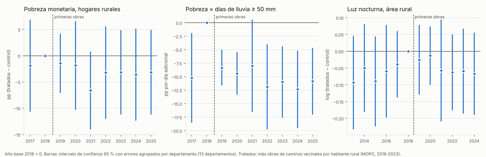

# Obras del MOPC y condiciones de vida rural: antes y después (2018-2024)

**Pregunta:** ¿las obras viales que el MOPC adjudicó entre 2018 y 2023 mejoraron la calidad de vida de la población rural, en especial en los cinco departamentos más pobres de la Región Oriental (Concepción, San Pedro, Caaguazú, Caazapá y Canindeyú)?

**Diseño:** antes y después, a nivel de **departamento × área (urbana/rural)**. Se comparan departamentos que recibieron muchas obras en caminos vecinales y departamentales (tratamiento) con departamentos que recibieron pocas (control), antes (2017-2018) y después (2023-2024) de las obras: **diferencias en diferencias**.

**Respuesta corta:** **no se encuentra un efecto robusto.** La pobreza rural bajó en los dos grupos y algo más en los departamentos tratados (−2 a −4 puntos), pero la diferencia no es significativa en ninguna especificación (tampoco con inferencia por aleatorización exacta ni con otras definiciones del tratamiento). Con 13 departamentos solo se pueden descartar efectos grandes: más de unos 6 puntos de pobreza con base 2017, más de 11 con base 2018. Tampoco hay efecto en privaciones de la vivienda, en acceso a escuela o salud, ni en la luz nocturna. Un resultado que parecía fuerte (las obras reducen la pobreza donde llueve fuerte más seguido) **no resiste la prueba placebo**: se explica porque 2018 fue un año atípico, no por las obras.

Archivos de esta carpeta:

| Archivo | Contenido |
|---|---|
| `base_modelo_hogares.csv` | **Base del modelo (hogares)**: 72.985 hogares de la EPHC 2017-2025 de los 13 departamentos de la muestra (39.166 rurales), solo con las variables que usan los modelos |
| `base_modelo_dpto_area_anio.csv` | **Base del modelo (panel)**: 13 departamentos × 2 áreas × 12 años (2013-2024): luz nocturna, lluvia y tratamiento |
| `diccionario_base_modelo.csv` | Diccionario de las dos bases |
| `obras_viales_MOPC_2018_2025_clasificadas.csv` | Las 272 adjudicaciones viales del MOPC, con tipo de obra, departamentos asignados y método de asignación |
| `obras_MOPC_por_departamento_anio.csv`, `tratamiento_por_departamento.csv`, `obras_MOPC_resumen_ubicacion.csv` | Montos por departamento y año, intensidad y grupos |
| `resultados_did.csv`, `resultados_estudio_eventos.csv`, `robustez_M7_sin_un_departamento.csv`, `descriptivos_antes_despues.csv` | Resultados |
| `estudio_eventos.png` | Gráfico de estudio de eventos |

Scripts (en orden): `_scripts/did_00_dncp_mopc_adjudicaciones.py`, `did_01_obras_mopc.py`, `did_02_ephc_hogares.py`, `did_03_luces_lluvia_dpto_area.py <carpeta CHIRPS diario>`, `did_04_modelos.py`, `did_05_graficos.py`.

## 1. Datos

| Rol | Variable | Fuente | Años |
|---|---|---|---|
| Resultados (hogares) | Pobreza total y extrema; ingreso per cápita en múltiplos de la línea de pobreza; índice de 6 privaciones (piso de tierra, agua sin red, sin saneamiento, leña o carbón, sin internet, sin auto ni moto); asistencia escolar de 6 a 17 años; consulta médica si estuvo enfermo; no consultó por falta de atención cercana | EPHC anual (INE), factor de expansión revisión 2025 | 2017-2025 |
| Resultado (territorio) | Luz nocturna por km² en el área rural y urbana de cada departamento | VIIRS VNL v2 | 2013-2024 |
| Tratamiento | Monto adjudicado por el MOPC en caminos vecinales y departamentales, por habitante rural | DNCP, descarga masiva OCDS (adjudicaciones); Censo 2022 | 2018-2023 |
| Controles | Lluvia anual y días con lluvia ≥ 50 mm del año, en el área del departamento; miembros del hogar, edad, sexo y años de estudio del jefe | CHIRPS v2.0 (anual y diario); EPHC | 2013-2024 |

### 1.1 Departamento en la EPHC 2018-2021

En 2018-2021 la EPHC publica solo "departamentos representativos" (`DPTOREP`): Concepción y Canindeyú, entre otros, quedan en "Resto". Pero las UPM (conglomerados) de 2018-2021 son las mismas de la muestra 2017, que sí trae el departamento. Se recuperó así el departamento de todos los hogares de 2018 (y del 97-99 % en 2019-2021). Donde `DPTOREP` sí identifica el departamento, coincide con el recuperado en el 99 % de las UPM. Eso permitió usar **2018 como línea de base**, como se pidió.

Advertencias:
- La EPHC 2018 tiene la mitad de hogares que la de 2017 (4.999 frente a 9.570) y sus pesos están calibrados para los dominios de `DPTOREP`, no para cada departamento de "Resto". Hay muy pocos hogares rurales en algunos departamentos (Concepción 83, Ñeembucú 66, Amambay 60, Paraguarí 70, Misiones 95), así que los promedios departamentales de 2018 son ruidosos y no representativos. Por eso todo se repite con **2017 como base** (muestra completa).
- La coincidencia UPM-departamento baja con los años (99 % en 2018, 97,5 % en 2020, 89,5 % en 2021): en 2020-2021 hasta un 10 % de los hogares de "Resto" puede quedar en un departamento equivocado. Solo afecta a los puntos 2020-2021 del estudio de eventos.

### 1.2 Obras del MOPC (tratamiento)

1. Se bajaron los archivos masivos de adjudicaciones de la DNCP (2018-2026) y se filtró el comprador MOPC con estado "Adjudicado" y fecha de adjudicación 2018-2025: **1.036 adjudicaciones**.
2. **Tipo de obra** (por texto del llamado y del lote): 272 son **obras viales** (22,5 billones de Gs); de ellas, 205 son en **caminos vecinales o departamentales** (5,9 billones). Se excluyen consultorías, fiscalización, compras de equipos y materiales, señalización, peajes, edificios, puertos y agua y saneamiento; las rutas nacionales (CREMA, corredores, "Ruta Nacional N°", accesos al segundo puente) cuentan como obra vial pero no como camino vecinal.
3. **Ubicación.** La DNCP no informa el departamento de la obra. Se asignó por el texto, en este orden: departamento nombrado en el lote; un único departamento en el título; distrito del lote dentro de los departamentos del título; varios departamentos en el título (monto repartido en partes iguales); nombre de distrito único en el país. Las 10 adjudicaciones más grandes con dudas se revisaron a mano (columna `revision_manual`). Resultado: el 75 % del monto se ubica en uno o más departamentos, el 16 % son rutas del Chaco y el **8 % queda sin ubicar** (licitaciones "en varios tramos de la Región Oriental" cuyos lotes no nombran el lugar).
4. **Intensidad** = Gs adjudicados en caminos vecinales y departamentales 2018-2023 (antes de la encuesta 2024) por habitante rural del Censo 2022.
5. **Grupos**: muestra de 13 departamentos de la Región Oriental (sin Asunción ni Central, que casi no tiene población rural en sentido estricto). **Tratamiento** = intensidad por encima de la mediana (1,8 millones de Gs por habitante rural); **control** = el resto.

| Departamento | Obras viales (miles de millones Gs) | Caminos vecinales y departamentales (miles de millones Gs) | Gs por habitante rural | Grupo |
|---|---|---|---|---|
| **San Pedro** (foco) | 1.570 | 1.173 | 4.424.804 | Tratamiento |
| **Canindeyú** (foco) | 678 | 397 | 3.391.014 | Tratamiento |
| **Caazapá** (foco) | 626 | 237 | 2.228.781 | Tratamiento |
| Ñeembucú | 658 | 589 | 23.869.346 | Tratamiento |
| Misiones | 356 | 192 | 4.400.595 | Tratamiento |
| Guairá | 243 | 243 | 2.371.116 | Tratamiento |
| **Concepción** (foco) | 1.101 | 171 | 1.803.945 | Control (es la mediana) |
| **Caaguazú** (foco) | 335 | 196 | 813.691 | Control |
| Amambay | 69 | 69 | 1.716.215 | Control |
| Alto Paraná | 975 | 211 | 1.483.914 | Control |
| Cordillera | 213 | 174 | 1.087.984 | Control |
| Paraguarí | 351 | 77 | 607.002 | Control |
| Itapúa | 491 | 132 | 590.531 | Control |

## 2. Especificación econométrica

**Modelo principal (M1), hogares rurales, 2018 y 2024:**

$$
Y_{idt} = \alpha_d + \lambda_t + \beta\,(\text{Tratado}_d \times \text{Post}_t) + X_{idt}'\theta + \gamma\,\text{Lluvia}_{dt} + \varepsilon_{idt}
$$

| Término | Definición |
|---|---|
| $Y_{idt}$ | Resultado del hogar *i* del departamento *d* en el año *t* (p. ej., 1 si es pobre) |
| $\alpha_d$ | Efecto fijo de departamento: descuenta las diferencias permanentes entre departamentos |
| $\lambda_t$ | Efecto fijo de año: descuenta lo que cambió en todo el país (crecimiento, pandemia, inflación) |
| $\text{Tratado}_d \times \text{Post}_t$ | 1 para los hogares de departamentos tratados en 2024 |
| $X_{idt}$ | Miembros del hogar, edad, sexo y años de estudio del jefe |
| $\text{Lluvia}_{dt}$ | Lluvia anual y días con lluvia ≥ 50 mm del año en el área rural del departamento |
| $\beta$ | **Efecto de las obras**: cuánto más cambió el resultado en los departamentos tratados que en los de control |

Estimación por mínimos cuadrados ponderados por el factor de expansión (modelo lineal de probabilidad para las variables 0/1).

**Variantes:**

| Modelo | Qué cambia |
|---|---|
| M2 Triple diferencia | Agrega los hogares urbanos y compara la brecha rural-urbana dentro de cada departamento: efectos fijos departamento × año, departamento × área y área × año. Descuenta todo shock departamental que afecte igual a urbanos y rurales |
| M3 Intensidad continua | Reemplaza Tratado por la intensidad (millones de Gs por habitante rural) |
| M4 | Antes = 2017-2018 juntos; después = 2023-2024 juntos |
| M8 | Antes = 2017 (muestra completa de la EPHC) |
| M5 | Agrega Tratado × Post × Departamento foco: ¿el efecto es distinto en los 5 departamentos foco? |
| M6 | Solo los 5 departamentos foco (San Pedro, Caazapá y Canindeyú frente a Concepción y Caaguazú) |
| M7 | Agrega Tratado × Post × días de lluvia ≥ 50 mm habituales del departamento (centrado): ¿las obras ayudan más donde la lluvia corta los caminos? |
| L1-L4 | Panel de luz nocturna 2013-2024: DiD rural, triple diferencia, intensidad acumulada al año anterior y tendencia previa |
| Estudio de eventos | Tratado × cada año (base 2018 = 0), para ver si los grupos venían igual antes de las obras |

**Inferencia:** errores estándar agrupados por departamento (13 grupos). Con tan pocos grupos se reporta además el p-valor de **wild cluster bootstrap restringido** (pesos de Webb, 999 repeticiones), que es el más confiable. Con los 5 departamentos foco solos (M6) ni siquiera el bootstrap es confiable. Para los modelos principales se agrega **inferencia por aleatorización exacta**: se recalcula el coeficiente con cada una de las 1.716 formas posibles de elegir 6 departamentos tratados entre 13 y se compara el coeficiente real con esa distribución.

## 3. Resultados

### 3.1 Antes y después, en promedio (hogares rurales)

| Grupo | Pobreza 2018 | Pobreza 2024 | Cambio |
|---|---|---|---|
| Tratamiento | 33,0 % | 24,4 % | −8,6 pp |
| Control | 25,3 % | 22,0 % | −3,3 pp |

La caída fue mayor en los tratados, pero con controles y efectos fijos la diferencia se reduce y no es significativa:

| Modelo | Pobreza (pp) | p wild | Pobreza extrema (pp) | Ingreso/línea (log) | Índice de privaciones |
|---|---|---|---|---|---|
| M1 DiD 2018 vs 2024 | −4,3 | 0,40 | −1,3 (p 0,64) | +0,00 (p 0,99) | +0,00 (p 0,91) |
| M8 DiD 2017 vs 2024 | −2,4 | 0,37 | −0,3 (p 0,73) | +0,03 (p 0,31) | +0,00 (p 0,93) |
| M4 2017/18 vs 2023/24 | −2,7 | 0,30 | +0,3 (p 0,87) | +0,00 (p 0,95) | −0,00 (p 0,85) |
| M2 Triple diferencia | −9,1 | 0,22 | −0,5 (p 0,88) | +0,03 (p 0,74) | +0,02 (p 0,65) |
| M3 Intensidad (por millón de Gs por hab. rural) | −0,0 | 0,90 | +0,0 (p 0,88) | −0,01 (p 0,26) | +0,005 (p 0,27) |

**Acceso a servicios (M1):** asistencia escolar +2,6 pp (p wild 0,24); consulta médica si estuvo enfermo +0,4 pp (p 0,88); "no consultó porque no hay atención cercana" −0,7 pp (p wild 0,09; es un evento raro, 1 % de los enfermos). **Componentes de las privaciones:** ninguno cambia de forma significativa; el más cercano a lo esperable es "sin auto ni moto" (−3,6 pp, p 0,27).

**Luz nocturna rural:** sin efecto (L1: +0,8 %, p 0,86; triple diferencia +1,8 %, p 0,76). La tendencia previa de los tratados no difiere de la de los controles (L4, p 0,19).

**Precisión (efecto mínimo detectable con 80 % de potencia):** con base 2018, 11 pp de pobreza; con base 2017, 6 pp. El diseño no puede detectar efectos moderados.

### 3.2 Pruebas de robustez del resultado principal (pobreza)

| Prueba | Base 2018 | Base 2017 |
|---|---|---|
| Inferencia por aleatorización exacta (las 1.716 formas de elegir 6 tratados entre 13) | −4,3 pp, p 0,42 | −2,4 pp, p 0,52 |
| Concepción como tratada (corte ≥ mediana) | −3,7 pp, p wild 0,44 | −1,5 pp, p wild 0,58 |
| Tratamiento sin las obras de pavimentación asfáltica | −4,2 pp, p wild 0,51 | −2,1 pp, p wild 0,54 |
| Tercil alto frente a tercil bajo de intensidad | −3,2 pp, p wild 0,71 | −0,0 pp, p wild 0,99 |
| Sin Ñeembucú (intensidad atípica por Alberdi-Pilar) | −4,5 pp, p wild 0,43 | −2,8 pp, p wild 0,28 |
| Log de la intensidad (continua) | −1,4 pp, p wild 0,57 | +1,0 pp, p wild 0,54 |
| Sin controles del hogar (tamaño, edad, sexo y estudios del jefe podrían responder a las obras) | −6,7 pp, p wild 0,18 | −3,9 pp, p wild 0,19 |

Ninguna variante es significativa. Agrupando 2017-2018 frente a 2023-2024 (M4), la aleatorización exacta da p = 0,31.

### 3.3 Tendencias previas (estudio de eventos)

- **Pobreza (panel izquierdo):** en 2017 los tratados estaban igual que en 2018 respecto de los controles (−1,9 pp, p 0,68): no hay tendencia previa. Después de 2018 la diferencia es de −1 a −7 pp, siempre con intervalos que incluyen el cero. Con **base 2017** la diferencia es de −1 a −2 pp en 2022-2025 (p ≥ 0,44); solo 2021 se acerca a la significación (−4,7 pp, p 0,07), un año con asignación de departamento menos precisa (ver 1.1).
- **Luz nocturna (panel derecho):** sin tendencia previa clara y sin cambio después de las obras.

### 3.4 Departamentos foco

- **M5:** en los cinco departamentos foco el efecto **no es mayor**; si algo, es menos favorable (+14 pp de pobreza respecto del efecto en el resto, p wild 0,38).
- **M6 (solo los 5 departamentos foco):** San Pedro, Caazapá y Canindeyú (más obras) no mejoraron más que Concepción y Caaguazú (pobreza +4,9 pp, p wild 0,13). Con 5 departamentos la inferencia no es confiable.

### 3.5 Lluvia: un resultado que no resiste

Con base 2018, las obras parecen reducir la pobreza **donde llueve fuerte más seguido** (M7: −16 pp por cada día adicional al año con lluvia ≥ 50 mm, p wild 0,015; +27 % de ingreso, p 0,008). Pero:

1. **Placebo (M7c):** el mismo "efecto" aparece, con signo contrario, entre 2017 y 2018, **antes de las obras** (+11 pp, p 0,03).
2. **Estudio de eventos de la interacción (panel central del gráfico):** 2017 y todos los años 2019-2025 están en el mismo nivel; el único año distinto es 2018. Es decir, en 2018 los departamentos tratados más lluviosos tuvieron un año malo (o una muestra mala) y luego volvieron a su nivel.
3. **Con base 2017 (M7g)** la interacción desaparece (−4 pp, p wild 0,51; aleatorización exacta p 0,25). El "efecto" con base 2018 (−16 pp) es casi la suma del bache de 2018 (+11 pp en el placebo) y la estimación con base 2017 (−4 pp).
4. Las versiones que todavía incluyen 2018 en la base (2017-2018 agrupados, M7e: −6 pp, p wild 0,04; lluvia anual media en vez de días intensos, M7f: −5 pp, p wild 0,06) siguen saliendo significativas por la misma razón. Además, esta heterogeneidad se buscó después de ver los datos, entre unos 70 coeficientes estimados.

**Conclusión:** la heterogeneidad por lluvia es un artefacto de la línea de base 2018, no un efecto de las obras. Se informa para que no se use.

## 4. Lectura de los resultados

1. **No hay evidencia de que las obras del MOPC 2018-2023 hayan reducido la pobreza ni las privaciones de los hogares rurales** a nivel departamental. El signo va en la dirección esperada (−2 a −4 pp de pobreza) pero el efecto es chico frente al ruido.
2. **"No hay evidencia de efecto" no es "no hay efecto".** El diseño tiene poca potencia: 13 departamentos, unos 150 hogares rurales por departamento en 2018, y obras que benefician a algunas compañías de un departamento, no a todo el departamento. Un efecto real pero local (en las compañías conectadas) se diluye al promediar todo el departamento.
3. **Los departamentos foco no aparecen como los más beneficiados.** San Pedro, Canindeyú y Caazapá recibieron mucha inversión por habitante rural, pero su pobreza rural no cayó más que la de Concepción y Caaguazú.

## 5. Limitaciones

1. **Ubicación de las obras por texto.** La DNCP no informa dónde se ejecuta la obra; el 8 % del monto no se pudo ubicar y en las licitaciones de varios departamentos el monto se repartió en partes iguales. Esto genera error de medida en la intensidad y sesga el efecto hacia cero.
2. **Adjudicado no es ejecutado.** Se usa el monto adjudicado y la fecha de adjudicación; no hay datos de avance físico ni de fecha de terminación.
3. **Unidad gruesa.** El departamento mezcla compañías con y sin obra. La EPHC no identifica distrito ni localidad, así que no se puede bajar de nivel con esta encuesta.
4. **Sin período previo limpio y asignación no aleatoria.** Los datos de la DNCP empiezan en 2018 y los 13 departamentos recibieron alguna obra vecinal en 2018-2020: se compara **dosis alta con dosis baja**, no departamentos con y sin obras. Los departamentos tratados son más pobres al inicio, lo que abre la puerta a regresión a la media. Lo adjudicado en 2022-2023 puede no estar terminado en la encuesta 2024. Dividir por la población rural infla la intensidad de departamentos chicos. Las obras pueden haberse dirigido a departamentos en mejor o peor situación; el estudio de eventos no muestra tendencias previas distintas, pero con un solo año previo en la EPHC (2017) la prueba es débil. La luz nocturna (2013-2018) tampoco muestra tendencias previas distintas.
5. **Pocos grupos.** Con 13 departamentos los errores agrupados subestiman la incertidumbre; por eso se usa el wild bootstrap. Ñeembucú tiene una intensidad muy alta por la pavimentación Alberdi-Pilar y pesa mucho en el modelo de intensidad continua.
6. **Efectos entre departamentos vecinos:** una obra en un departamento puede beneficiar al de al lado (contaminación del grupo de control).
7. **2020** fue un año de pandemia, con encuesta en condiciones especiales; los efectos fijos de año absorben el shock común.

## 6. Revisión econométrica independiente

Un agente analista experto en econometría (definido en `.claude/agents/analista-econometria.md`, ficha en `_equipo_agentes/econometria.md`) revisó el código y los resultados:
- **Estimador:** la clase `Fit` coincide con statsmodels (WLS con errores agrupados) en 4 decimales, y el wild bootstrap reimplementado por separado da los mismos p-valores (salvo ruido de simulación).
- **Codificación:** la de la EPHC está bien. A partir de la revisión, los códigos "no responde" pasan a faltante en las privaciones.
- **Clasificación de obras:** se corrigió la expresión regular de rutas "PY-15" (Chaco).
- **Pruebas nuevas:** a sugerencia de la revisión se agregaron la inferencia por aleatorización exacta, las definiciones alternativas del tratamiento, la versión sin controles del hogar, el estudio de eventos con base 2017 y el efecto mínimo detectable.
- **Conclusión:** la revisión la considera correcta. La redacción adoptada: *no hay evidencia robusta de efecto, lo que no equivale a demostrar que no hubo efecto.*

## 7. Próximos pasos sugeridos

1. **Bajar a la escala de la obra:** georreferenciar los tramos adjudicados (los títulos de lote nombran los extremos: "Capiibary - Primero de Marzo", "Santa Clara - Jhugua Rey - Choré") y comparar **localidades a menos de 5 km de un tramo intervenido** con localidades más lejanas del mismo distrito, usando el Censo 2022 y la luz nocturna por localidad (2013-2024). Es el diseño con más potencia.
2. Pedir al MOPC el listado de obras con coordenadas, fecha de inicio y fin y avance físico.
3. Repetir el análisis con la **EPHC trimestral** para tener más observaciones por año.
