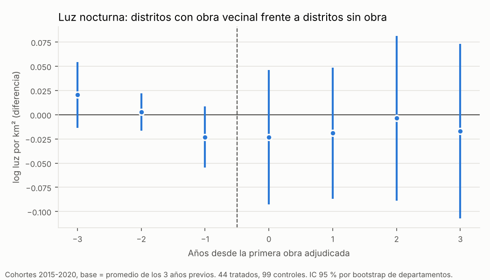

# Obras del MOPC en caminos vecinales y NBI por distrito: Censo 2012 frente a Censo 2022

**Pregunta:** ¿los distritos que recibieron obras del MOPC en caminos vecinales entre 2012 y 2020 redujeron más sus necesidades básicas insatisfechas (NBI) que los distritos sin obras?

**Diseño:** diferencias en diferencias con dos censos. Se mide el NBI de cada distrito **antes** (Censo 2012) y **después** (Censo 2022) y se compara cuánto bajó en los distritos **con obra** frente a los distritos **sin obra**, dentro del mismo departamento.

**Respuesta corta:** **no hay evidencia de efecto.**
- **Los dos grupos partían igual:** en 2012 los distritos con obra tenían 55,8 % de hogares con NBI y los distritos sin obra, 56,8 %.
- **Los dos bajaron casi lo mismo:** unos 22,5 puntos hasta 2022.
- **Sin diferencia significativa:** la diferencia entre ambos es de 0,3 a 0,8 puntos a favor de los distritos con obra y no es significativa en ninguna especificación, tampoco con inferencia por permutación.
- **Qué se puede descartar:** con la especificación que controla por el NBI inicial, el intervalo de confianza descarta reducciones mayores a unos 2 puntos asociadas a tener una obra *que se pudo ubicar* (unos 3 puntos sin ese control).
- **Límite que podría ser mayor:** cerca de la mitad del monto no se pudo ubicar por distrito, así que parte de los distritos "sin obra" probablemente recibió obras. Por eso el efecto real de las obras podría superar ese límite (sección 5).
- **Luz nocturna:** tampoco cambia después de las obras.
- **Alcance:** es una comparación con supuestos fuertes, no un efecto causal probado.

Archivos:

| Archivo | Contenido |
|---|---|
| `base_modelo_distrital_nbi.csv` | **Base del modelo**: 263 distritos con NBI 2012 y 2022, obras, controles y la marca de muestra (203 distritos) |
| `diccionario_base_modelo_distrital.csv` | Diccionario |
| `obras_vecinales_MOPC_2012_2025_por_distrito.csv` | Las 510 adjudicaciones de caminos vecinales y departamentales 2012-2025, con distritos asignados, método y nombres encontrados |
| `obras_vecinales_por_distrito.csv`, `obras_vecinales_solo_departamento_2012_2020.csv`, `resumen_ubicacion_por_distrito_2012_2020.csv` | Obras por distrito y calidad de la ubicación |
| `resultados_nbi_2012_2022.csv`, `descriptivos_con_y_sin_obra.csv`, `sensibilidad_contaminacion_control.csv` | Resultados del NBI |
| `resultados_luces_estudio_eventos.csv`, `resultados_luces_resumen.txt`, `luces_estudio_eventos.png` | Complemento con luz nocturna |

Scripts: `_scripts/cen_00_nbi_2012_tableau.py`, `did_00_dncp_mopc_adjudicaciones.py <carpeta> 2012 2025`, `cen_01_obras_por_distrito.py`, `cen_02_modelos_distritales.py`, `cen_03_luces_estudio_eventos.py`. Las reglas de clasificación de obras (`obras_mopc_reglas.py`) y el estimador (`econometria.py`) son los mismos del análisis departamental (`15_`).

## 1. Datos

### 1.1 NBI 2012 y 2022

- **2012:** el INE publica el porcentaje de hogares con al menos una NBI por distrito del Censo 2012 solo como un mapa interactivo de Tableau Public. Se bajó el libro completo y se leyó su tabla de datos: 250 distritos (`12_INE_complementario/NBI_distrital_2012_2022/`).
- **2022:** mismo indicador del Censo 2022 (INE).
- **Comparabilidad:** el INE presenta las NBI de 1982 a 2022 como una serie con las mismas cuatro dimensiones (calidad de la vivienda, infraestructura sanitaria, acceso a la educación y capacidad de subsistencia).
- **Censo 2012 incompleto:** llegó a cerca del 80 % de la población. Por eso se usan porcentajes, no totales. Se supone, sin poder probarlo, que la omisión no fue distinta entre distritos con y sin obra.
- **Compresión entre censos:** el NBI distrital no solo baja (de 56 % a 34 % en promedio); también se vuelve mucho más parejo entre distritos (la desviación estándar pasa de 13,8 a 7,9 puntos) y el cambio está muy correlacionado con el nivel de 2012 (−0,84). Parte de esa compresión puede venir de la omisión del Censo 2012, probablemente mayor en zonas rurales y alejadas, o de cambios en los criterios de los componentes. Como afecta por igual a distritos con y sin obra, no debería sesgar la comparación, pero agrega ruido.
- **Distritos comparables:** desde 2012 se crearon 13 distritos nuevos. Con los límites de 2012 (incluidos en el mapa del INE) y los de 2022 se marcó como **estable** a un distrito si el mismo código cubre al menos el 85 % de su territorio en los dos censos. Esto deja fuera a los distritos nuevos y a aquellos de los que se separaron.

### 1.2 Obras por distrito

1. **Adjudicaciones:** 2.619 adjudicaciones del MOPC 2012-2025 de la descarga masiva de la DNCP (que empieza en 2011). Con las mismas reglas del análisis departamental, 510 son obras en caminos vecinales o departamentales; 477 son de 2012-2020.
2. **Ubicación por distrito:** se buscó, dentro de los departamentos ya asignados, el nombre de cada distrito y de cada localidad del Censo 2022 en el texto del lote (por ejemplo "Tramo Santa Fe del Paraná - Mbaracayú") y, si el lote no dice nada, en el título del llamado. Se descartan nombres genéricos (por ejemplo, "nacional" u "oriental" son nombres de compañías) y, si un nombre está dentro de otro más largo (Santa Rosa / Santa Rosa del Aguaray), se queda el más largo.
3. **Revisión manual:** se leyeron las 70 obras más grandes y se aplicaron 22 correcciones. Los errores típicos eran compañías con el mismo nombre en varios distritos (Santa Clara, María Auxiliadora, Santa Rita) y ríos tomados por distritos (Tebicuary, Yguazú). La revisión también encontró que la "Ruta Nº 8" no se reconocía como ruta nacional; se corrigió la regla, lo que cambió una sola adjudicación chica del análisis departamental.

| Ubicación de las obras vecinales 2012-2020 | Adjudicaciones | Parte del monto |
|---|---|---|
| Distrito identificado por nombre (lote o título) | 117 | 32 % |
| Distrito corregido a mano | 21 | 14 % |
| Solo departamento ("Lote 3", "Departamento de San Pedro") | 152 | 28 % |
| Sin ubicación | 187 | 25 % |

Hay 135 distritos con al menos una obra ubicada entre 2012 y 2020.

4. **Tratamiento:** un distrito es **tratado** si tiene al menos una obra vecinal ubicada adjudicada entre 2012 y 2020 (las de 2021 en adelante difícilmente estaban terminadas en el censo de octubre de 2022). **Control:** distritos sin obra ubicada.

**Muestra:** 203 distritos estables de la Región Oriental, sin Asunción ni Central (Central es urbano y sus obras son pavimento urbano): 104 con obra y 99 sin obra ubicada.

## 2. Especificación econométrica

Con dos períodos, la diferencia en diferencias

$$\text{NBI}_{dt} = \alpha_d + \lambda_{k(d),t} + \beta\,(\text{Obra}_d \times \text{2022}_t) + \varepsilon_{dt}$$

equivale a regresar el **cambio** del NBI de cada distrito sobre la obra:

$$\Delta\text{NBI}_d = \text{NBI}_{d,2022} - \text{NBI}_{d,2012} = \lambda_k + \beta\,\text{Obra}_d + X_d'\theta + \varepsilon_d$$

| Término | Definición |
|---|---|
| $\Delta\text{NBI}_d$ | Cambio del porcentaje de hogares con al menos una NBI entre 2012 y 2022 en el distrito *d* (puntos porcentuales; negativo = mejora) |
| $\text{Obra}_d$ | 1 si el distrito tuvo al menos una obra vecinal ubicada adjudicada entre 2012 y 2020 |
| $\lambda_k$ | Efecto fijo de departamento: compara distritos del mismo departamento y descuenta todo lo que cambió igual en el departamento |
| $X_d$ | Controles: % de población rural, log de densidad, log de superficie, lluvia media; en algunas variantes, el NBI de 2012 |
| $\beta$ | **Efecto de la obra:** cuántos puntos más (o menos) bajó el NBI en los distritos con obra |

El efecto fijo del distrito ($\alpha_d$) se cancela al tomar la diferencia: todo lo permanente del distrito (geografía, distancia a la capital, suelos) queda descontado.

**Variantes:**

| Modelo | Qué cambia |
|---|---|
| C1 | Solo obra y efectos fijos de departamento |
| C2 | + controles |
| C3 | + NBI de 2012. Los distritos más pobres en 2012 bajaron más (convergencia); si las obras fueron a distritos más pobres, sin este control se confundiría convergencia con efecto |
| C4 | Intensidad: log del monto por habitante rural |
| C5 | Obra temprana (2012-2016, más tiempo para notar efectos) frente a tardía (2017-2020) |
| C6 | ¿El efecto es distinto en los 5 departamentos foco? |
| C7 | Solo los 5 departamentos foco |
| C8 | Ponderado por población |
| C9 | Solo departamentos con pocas obras sin ubicar (menos riesgo de que un distrito "sin obra" haya tenido una) |
| C10 | Dosis: 1, 2 y 3 o más obras ubicadas |

**Inferencia:** se reportan errores agrupados por departamento (13 grupos) con wild cluster bootstrap e intervalos con la t de 12 grados de libertad, errores robustos por distrito y, para C1 y C3, **inferencia por permutación**: se reasigna la obra al azar entre distritos del mismo departamento 2.000 veces y se ve qué tan raro es el coeficiente observado.

## 3. Resultados

### 3.1 Antes y después

| Grupo | Distritos | NBI 2012 | NBI 2022 | Cambio |
|---|---|---|---|---|
| Con obra 2012-2020 | 104 | 55,8 % | 33,3 % | −22,5 pp |
| Sin obra ubicada | 99 | 56,8 % | 34,1 % | −22,7 pp |
| Foco, con obra | 38 | 62,1 % | 36,8 % | −25,3 pp |
| Foco, sin obra ubicada | 30 | 60,3 % | 34,5 % | −25,8 pp |

Los grupos son parecidos antes de las obras: NBI, % rural, densidad y lluvia casi iguales.

### 3.2 Estimaciones

| Modelo | Efecto de la obra en el NBI (pp) | IC 95 % | p wild (dpto.) | p robusto | p permutación |
|---|---|---|---|---|---|
| C1 Obra + EF de departamento | −0,3 | [−3,2; +2,6] | 0,81 | 0,79 | 0,77 |
| C2 + controles | −0,7 | [−4,2; +2,7] | 0,65 | 0,49 | — |
| **C3 + NBI 2012** | **−0,8** | **[−2,2; +0,6]** | **0,25** | **0,22** | **0,19** |
| C4 Intensidad (por unidad de log) | −0,15 | [−0,5; +0,2] | 0,46 | 0,33 | — |
| C5 Obra temprana (2012-2016) | −0,5 | [−2,1; +1,1] | 0,53 | 0,46 | — |
| C5 Obra tardía (2017-2020) | −1,6 | [−4,1; +0,8] | 0,17 | 0,16 | — |
| C6 Diferencia en departamentos foco | +1,9 | [−0,7; +4,6] | 0,21 | 0,17 | — |
| C7 Solo departamentos foco | +0,2 | [−1,1; +1,5] | 0,69 | 0,87 | — |
| C8 Ponderado por población | −0,2 | [−1,0; +0,7] | 0,68 | 0,77 | — |
| C9 Departamentos con pocas obras sin ubicar | −0,2 | [−2,0; +1,6] | 0,86 | 0,81 | — |
| C10 Dosis: 1 / 2 / 3 o más obras | −1,1 / −0,1 / −0,9 | — | 0,19 / 0,90 / 0,41 | — | — |

Intervalos con errores agrupados por departamento y la t de 12 grados de libertad.

**En palabras:**
1. Los distritos con obra no redujeron sus NBI más que los distritos sin obra del mismo departamento. Todas las estimaciones están entre −1,6 y +1,9 puntos y ninguna es significativa.
2. Con el control por el NBI inicial (C3), el intervalo descarta reducciones mayores a 2,2 puntos asociadas a tener una obra ubicada, en un período en que el NBI bajó 22 puntos en todos los distritos. C1 (diferencia en diferencias pura) y C3 (cambio controlando el nivel inicial) se apoyan en supuestos distintos sobre la convergencia y los dos dan cero.
3. No hay relación dosis-respuesta: con 1, 2 o 3 o más obras los coeficientes no crecen.
4. **Las obras temprana y tardía no se pueden comparar bien:** la ubicación por distrito funciona mucho mejor en 2012-2016 (43 % del monto) que en 2017-2020 (18 %), así que C5 compara también la calidad de la ubicación, no solo el tiempo de exposición.
5. En los departamentos foco el resultado es el mismo (C7: +0,2 pp).

### 3.3 Complemento: luz nocturna año a año

Dos censos no permiten ver si los grupos venían con tendencias parecidas. La luz nocturna sí se mide todos los años (2012-2024), así que se comparó la luz de los distritos con obra antes y después de su primera obra, frente a los distritos sin obra ubicada entre 2012 y 2020. El estimador es del tipo Callaway y Sant'Anna: compara cada cohorte (año de la primera obra) con los distritos sin obra y luego promedia.

Para que cada año de la ventana tenga las mismas cohortes, se usan solo las cohortes 2015-2020 (44 distritos) con una ventana de −3 a +3 años. La base es el promedio de los tres años previos a la obra, no un único año, y los errores salen de un bootstrap que remuestrea departamentos enteros.

- **Después de la obra la luz no cambia:** diferencia promedio de los años 0 a +3 respecto de los años previos = −0,016 (EE 0,035).
- **Antes de la obra:** hay una leve tendencia a la baja en los distritos tratados (de +0,02 a −0,02 en tres años, no significativa). Si existe, iría en contra de encontrar un efecto positivo.
- **Advertencia:** una primera versión, con base en el año anterior a la obra y todas las cohortes, daba un resultado algo distinto (+0,02). El signo depende del año base; en ninguna versión hay un efecto distinguible de cero.

## 4. Lectura de los resultados

1. **No hay evidencia de que las obras del MOPC en caminos vecinales hayan reducido las NBI de los distritos** entre 2012 y 2022, ni en el país ni en los departamentos foco. Coincide con el análisis departamental con la EPHC (`15_`).
2. **Este diseño tiene más potencia** que el departamental (203 distritos frente a 13 departamentos): el resultado nulo es más informativo. Descarta efectos grandes asociados a las obras que se pudieron ubicar, no efectos chicos, no el efecto de las obras no ubicadas y no efectos concentrados en las compañías cercanas al tramo.
3. **El NBI mide carencias estructurales** (vivienda, saneamiento, escolaridad, capacidad de subsistencia), que cambian lento. Un camino puede mejorar el acceso a salud o la venta de productos sin mover el NBI en 10 años.

## 5. Limitaciones

1. **Control contaminado.** Solo el 47 % del monto de obras vecinales 2012-2020 se ubicó en un distrito. Si una fracción π de los distritos "sin obra" tuvo una obra no ubicada, el coeficiente estimado es más o menos (1 − π) veces el efecto real. El límite de 2,2 puntos de C3 pasa a 2,8 puntos si π = 0,2; a 3,7 si π = 0,4; y a 4,5 si π = 0,5 (`sensibilidad_contaminacion_control.csv`). C9 (departamentos con pocas obras sin ubicar) da lo mismo, pero no resuelve el problema. La forma de medir π sería codificar a mano una muestra de las obras no ubicadas con los pliegos o pedir al MOPC la ubicación.
2. **Selección por cómo se busca.** Los distritos más grandes tienen más probabilidad de tener una obra ubicada (más localidades = más nombres que encontrar). El NBI de 2012 no predice tener obra, y los modelos controlan por la superficie.
3. **Ubicación por texto.** Solo se revisaron a mano las 70 obras más grandes; en las demás puede haber errores de nombre.
4. **Adjudicado no es ejecutado.** No hay datos de terminación ni de avance físico.
5. **Escala.** El distrito promedia compañías conectadas y no conectadas por la obra. El NBI 2012 solo está disponible a nivel de distrito y como total (no rural ni por componente), así que no se puede bajar de escala ni separar el área rural.
6. **Selección y tendencias previas.** Las obras no se asignaron al azar. Los grupos eran parecidos en 2012 y en la luz nocturna solo hay una leve tendencia previa a la baja, no significativa. Pero no hay una prueba de tendencias previas para el NBI (solo hay dos censos). Además, casi no hay obras ubicadas después del censo (la ubicación por distrito no funciona para 2021-2025: los lotes de esos años no nombran lugares), así que no se puede hacer el placebo con obras futuras.
7. **Censo 2012 incompleto** (cerca del 80 % de cobertura).

## 6. Revisión econométrica

El agente analista de econometría (`.claude/agents/analista-econometria.md`) revisó el análisis:
- **Cifras:** rehízo las principales y coinciden.
- **Cambios incorporados a partir de la revisión:**
  - intervalos con la t de 12 grados de libertad y la inferencia por permutación;
  - la prueba de dosis y el análisis de sensibilidad a la contaminación del control;
  - un nuevo estudio de luz nocturna: cohortes balanceadas, base promedio, bootstrap por departamento y control sin condicionar a obras futuras;
  - las advertencias sobre la compresión del NBI y sobre la comparación de obras tempranas y tardías.
- **Conclusión:** la considera defendible con los matices que se agregaron arriba.

## 7. Próximos pasos posibles

1. **Medir la contaminación del control:** codificar a mano una muestra al azar de unas 40 obras no ubicadas (con los pliegos de la DNCP) para estimar qué parte de los distritos "sin obra" tuvo obras.
2. Pedir al INE por la Ley 5282 el NBI 2012 por **localidad** o por área urbana/rural, y por componente, para comparar las localidades atravesadas por los tramos con las demás.
3. Ubicar los tramos en el mapa (extremos nombrados en los lotes) y medir la distancia de cada localidad al tramo intervenido.
