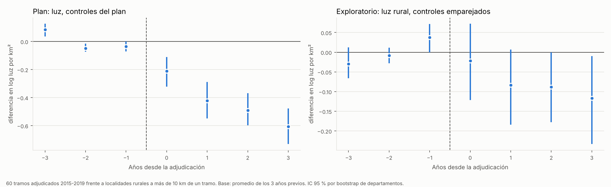

# Efecto local de los tramos vecinales del MOPC: luz nocturna alrededor de cada tramo

**Pregunta:** alrededor de un tramo vecinal adjudicado por el MOPC, ¿aumentó la actividad económica (medida con la luz nocturna) después de la obra, en comparación con zonas rurales sin obra ubicada?

**Cómo se hizo:** el plan (unidades, controles, estimador y criterio) se escribió y se subió **antes** de estimar: `PLAN_DE_ANALISIS.md`. Lo que no estaba en el plan se informa como exploratorio.

**Respuesta corta:** **no hay evidencia de un efecto positivo en la luz nocturna alrededor de los tramos.**
- **Resultado del plan:** da un efecto negativo grande, pero no es creíble. Los controles elegidos (localidades rurales alejadas) son mucho más oscuros que las zonas de los tramos, y la luz satelital de las zonas oscuras sube distinto con los años.
- **Comparación más justa:** con controles de luz inicial parecida y midiendo solo la parte rural de cada zona, el efecto es −0,08 en logaritmo y el intervalo incluye el cero.
- **Superficie de los caminos:** la "primera etapa" (si los caminos mejoraron según OpenStreetMap) no se pudo medir porque los servicios del historial de OSM estaban caídos.

Archivos:

| Archivo | Contenido |
|---|---|
| `PLAN_DE_ANALISIS.md` | Plan fijado antes de estimar |
| `unidades_tratados_y_controles.gpkg` | 60 tramos tratados (adjudicados 2015-2019) y 400 localidades rurales de control |
| `luces_por_unidad_anio.csv`, `luces_por_unidad_anio_solo_rural.csv` | Luz nocturna anual 2012-2024 en cada zona (franjas de 3 y 1,5 km; y solo la parte rural) |
| `resultados_efecto_local.csv`, `resultados_efecto_local_por_anio.csv` | Resultados (efecto promedio y por año) |
| `efecto_local_tramos.png` | Gráfico |

Scripts: `_scripts/loc_01_unidades_y_luces.py`, `_scripts/loc_03_estimaciones.py`.

## 1. Diseño

- **Tratados:** 60 tramos de `18_tramos_georreferenciados`, de la Región Oriental sin Central, adjudicados entre 2015 y 2019. Son 6 de 2015, 13 de 2016, 20 de 2017, 2 de 2018 y 19 de 2019; 35 tienen trazado (línea) y 25 son un solo punto. Las obras de 2012-2014 no entran porque la luz satelital empieza en 2012 y no tienen tres años previos.
- **Zona:** franja de 3 km alrededor del tramo.
- **Controles:** 400 localidades rurales de los mismos departamentos, a más de 10 km de cualquier tramo ubicado, con un círculo de 3 km.
- **Estimador:** diferencias en diferencias escalonado del tipo Callaway y Sant'Anna.
  - Para cada cohorte (año de adjudicación), se compara el cambio de la luz en los tramos con el cambio en los controles, respecto del promedio de los tres años previos.
  - El efecto principal es el promedio de los años 0 a +3.
  - El intervalo de confianza sale de un bootstrap que remuestrea departamentos.
  - **Criterio fijado:** hay evidencia de efecto si el promedio es positivo y su intervalo excluye el cero.

## 2. Resultados

| Análisis | Efecto promedio años 0 a +3 (log luz por km²) | IC 95 % | Tratados / controles |
|---|---|---|---|
| **Plan: principal** | **−0,43** | [−0,54; −0,32] | 60 / 400 |
| Plan S1: solo tramos con trazado | −0,38 | [−0,50; −0,25] | 35 / 400 |
| Plan S2: controles a 10-30 km | −0,43 | [−0,54; −0,31] | 60 / 377 |
| Plan S3: franja de 1,5 km | −0,50 | [−0,65; −0,31] | 60 / 400 |
| Exploratorio E1: controles con luz inicial en el rango de los tramos | −0,12 | [−0,19; −0,03] | 60 / 93 |
| Exploratorio E2: 5 controles por tramo, mismo departamento y luz inicial parecida | −0,13 | [−0,19; −0,08] | 60 / 122 |
| **Exploratorio E3: E2 midiendo solo la parte rural de cada zona** | **−0,08** | **[−0,17; +0,01]** | 60 / 135 |
| Exploratorio E4: solo parte rural, controles del plan | −0,31 | [−0,43; −0,18] | 60 / 400 |

### Por qué el resultado del plan no es creíble

1. **Los grupos no son comparables:** al inicio (2014), la luz de las zonas de los tramos era 5,95 en logaritmo y la de los controles, 2,85. Los tramos unen pueblos y cabeceras distritales; los controles son compañías alejadas, en general oscuras.
2. **La luz de las zonas oscuras sube distinto:** en los controles salta en 2017 (de 2,86 a 3,67) y sigue subiendo, mucho más que en las zonas de los tramos. Es típico de cambios en el procesamiento del producto satelital en zonas de poca luz y de la electrificación rural. El supuesto de tendencias paralelas no se cumple.
3. **Al comparar con controles de luz inicial parecida** (E1, E2) el efecto se achica a la cuarta parte y las tendencias previas quedan planas.

### Por qué queda un efecto negativo chico

- **Zonas urbanas:** las zonas de los tramos incluyen centros urbanos, donde la luz medida puede bajar cuando el alumbrado público pasa a LED, porque el satélite capta mal la luz blanca. Al medir solo la parte rural de cada zona (E3), el efecto baja a −0,08 y el intervalo incluye el cero.
- **Tendencias previas inestables:** en E3 van de −0,03 a +0,04, así que ni siquiera esa estimación es muy firme.

## 3. Lectura

1. **No se observa que la luz nocturna aumente alrededor de los tramos intervenidos.** La comparación más justa da un efecto cercano a cero (ligeramente negativo, no significativo).
2. **La luz nocturna sirve poco para medir el efecto de caminos rurales:** responde a la electrificación, al alumbrado urbano y a cambios del satélite más que a la actividad que genera un camino vecinal. Es una razón más para conseguir resultados más directos, como la matrícula escolar o las consultas de salud.
3. **Sin primera etapa no se sabe si el camino cambió:** no pudimos verificar con OpenStreetMap si los tramos adjudicados efectivamente mejoraron de superficie.

## 4. Limitaciones

- **Primera etapa pendiente:** los servicios del historial de OpenStreetMap (ohsome: error 503; Overpass: conexión cortada) no estaban disponibles el 25/10/2026.
- **Ubicación y trazado aproximados:** solo el 43 % del monto de obras está ubicado y el trazado es una línea recta entre extremos. Los controles pueden haber tenido obras no ubicadas.
- **Adjudicado no es ejecutado:** se mide desde la adjudicación, no desde la terminación de la obra.
- **Pocas cohortes:** 60 tramos, 5 años de adjudicación, y las cohortes 2016, 2017 y 2019 dominan.

## 5. Próximos pasos

1. **Primera etapa:** repetir la consulta a ohsome cuando el servicio vuelva, con la proporción de caminos pavimentados, empedrados o de ripio en cada zona y año, y el mismo estimador.
2. **Matrícula del MEC por escuela:** es el resultado más directo y está pendiente (portal caído). Se puede pedir por la Ley 5282.
3. **Trazado real:** cambiar la línea recta por el recorrido sobre la red de OpenStreetMap entre los extremos.
