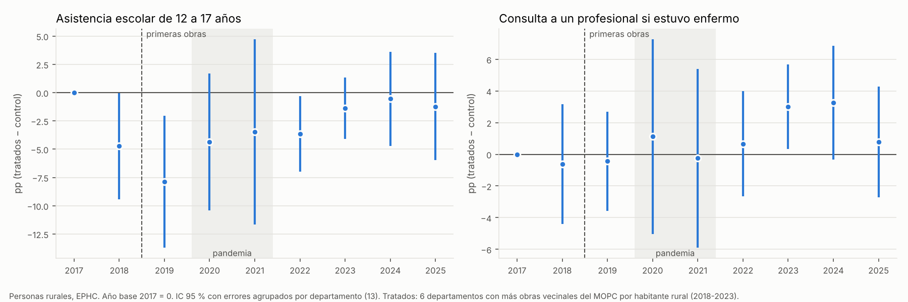

# Obras del MOPC y acceso a educación y salud de la población rural (modelo departamental)

**Pregunta:** en los departamentos con más obras del MOPC en caminos vecinales y departamentales (2018-2023), ¿mejoró más el acceso de la población rural a la escuela y a la atención de salud que en los departamentos con menos obras?

**Cómo se hizo:** es el mismo diseño del análisis departamental (`15_`), pero con resultados de educación y salud en lugar de la pobreza. El plan se fijó y se subió **antes** de estimar (`PLAN_DE_ANALISIS.md`).

**Respuesta corta:**
- **Salud:** la consulta a un profesional cuando la persona estuvo enferma subió **3,5 puntos más** en los departamentos con más obras (sobre una base de 66 %). Es la señal más clara de todos los análisis hechos, pero **no alcanza el criterio fijado** (p 0,07 en el wild bootstrap y 0,09 en la aleatorización) y en 2025 se achica.
- **Educación:** la asistencia escolar de 12 a 17 años no muestra un efecto claro (+1,6 puntos, no significativo, y cero si se compara 2017 con 2024).
- **En conjunto:** hay **indicios compatibles con un mejor acceso a la salud**, pero no evidencia firme.

Archivos: `base_modelo_personas.csv` (base del modelo: personas de la EPHC 2017-2025, solo con las variables usadas), `resultados_salud_educacion.csv`, `resultados_estudio_eventos.csv`, `descriptivos_por_grupo_anio.csv`, `estudio_eventos_salud_educacion.png`. Scripts: `_scripts/did_06_salud_educacion.py`, `_scripts/did_07_grafico_salud_educacion.py`.

## 1. Resultados elegidos

| Resultado | Definición (EPHC) | Por qué |
|---|---|---|
| **Asistencia escolar de 12 a 17 años** (principal) | Asiste a una institución de enseñanza | A esa edad la escuela suele estar más lejos (educación media) y la asistencia tiene margen para subir (83 %). La de 6 a 11 años es casi universal (99 %) |
| **Consulta a un profesional si estuvo enfermo** (principal) | Entre quienes estuvieron enfermos o accidentados en los últimos 90 días: consultó a médico, enfermero, partera profesional o dentista | Depende de poder llegar a un servicio de salud |
| No asiste porque no hay escuela cercana (secundario) | Motivo de no asistencia, sobre todas las personas de 6 a 17 años | Mide directamente la distancia como barrera |
| No consultó porque no hay atención cercana (secundario) | Motivo de no consulta, sobre los enfermos | Idem para la salud |
| Se atendió en un establecimiento del Ministerio de Salud (secundario) | Hospital, centro, puesto o Unidad de Salud Familiar, entre quienes consultaron | Uso de la red pública |

## 2. Especificación

$$Y_{idt} = \alpha_d + \lambda_t + \beta\,(\text{Tratado}_d \times \text{Después}_t) + X_{idt}'\theta + \varepsilon_{idt}$$

- **Unidad:** personas de hogares rurales de 13 departamentos de la Región Oriental.
- **Antes y después:** antes = 2017-2018; después = 2023-2024. Agrupar dos años reduce el peso de un año atípico.
- **Tratados:** 6 departamentos con más obras por habitante rural (San Pedro, Canindeyú, Caazapá, Guairá, Misiones y Ñeembucú).
- **Controles $X$:** edad, sexo, tamaño del hogar y años de estudio del jefe.
- **Estimación:** mínimos cuadrados ponderados con el factor de expansión.
- **Inferencia:** wild cluster bootstrap por departamento y aleatorización exacta (1.716 asignaciones posibles).
- **Criterio fijado:** signo esperado con p < 0,025 en las dos pruebas. El umbral es 0,025 porque hay dos resultados principales.

## 3. Resultados

| Resultado | Base antes (rurales) | Efecto (pp) | IC 95 % | p wild | p aleatorización |
|---|---|---|---|---|---|
| **Asistencia 12-17** | 83,3 % | **+1,6** | [−1,7; +4,8] | 0,30 | 0,36 |
| **Consulta a profesional si estuvo enfermo** | 66,4 % | **+3,5** | [+0,5; +6,6] | 0,07 | 0,09 |
| Asistencia 6-11 | 99,4 % | −0,5 | [−1,4; +0,4] | 0,26 | 0,35 |
| No asiste por falta de escuela cercana | 1,2 % | −0,45 | [−1,0; +0,1] | 0,08 | 0,09 |
| No consultó por falta de atención cercana | 0,9 % | −0,2 | [−0,9; +0,5] | 0,59 | 0,54 |
| Se atendió en un establecimiento del Ministerio | 78,8 % | +3,1 | [−1,1; +7,4] | 0,19 | 0,24 |

**Pruebas secundarias de los dos resultados principales:**

| Prueba | Asistencia 12-17 | Consulta a profesional |
|---|---|---|
| 2018 frente a 2024 | +4,1 pp (p wild 0,13) | +4,0 pp (p wild 0,15) |
| 2017 frente a 2024 | −0,2 pp (p wild 0,94) | +3,2 pp (p wild 0,22) |
| Triple diferencia (rural frente a urbano) | +2,4 pp (p wild 0,45) | +1,8 pp (p wild 0,49) |
| Diferencia en los 5 departamentos foco | +2,5 pp (p wild 0,20) | +1,5 pp (p wild 0,44) |

### Estudio de eventos (base 2017)

- **Consulta a un profesional:**
  - Antes de las obras, los dos grupos venían igual (2018 y 2019 cerca de cero).
  - Desde 2023 los departamentos tratados quedan unos 3 puntos por encima (2023: +3,0, p 0,05; 2024: +3,3, p 0,10).
  - En 2025 la diferencia baja a +0,8.
  - Es el patrón que se esperaría si las obras facilitaran llegar al servicio de salud, aunque no es estadísticamente firme.
- **Asistencia escolar de 12 a 17:**
  - En 2018 y 2019 los departamentos tratados cayeron respecto de 2017 y después se recuperaron hasta quedar en cero.
  - El +1,6 del modelo principal viene de esa caída previa, no de una mejora posterior: no hay efecto.

## 4. Lectura

1. **El acceso a la salud es el canal más prometedor.** Es el resultado con el patrón más coherente:
   - tendencias previas planas y una suba de unos 3 puntos varios años después de las adjudicaciones;
   - menos personas que no van a la escuela por falta de escuela cercana (−0,45 puntos sobre una base de 1,2 %, p 0,08);
   - más atención en establecimientos públicos (+3,1 puntos).

   Ninguno cumple el umbral fijado, pero todos van en la misma dirección.
2. **La asistencia escolar no responde.** La de 6 a 11 años ya es casi universal y la de 12 a 17 no muestra mejora una vez que se mira la tendencia.
3. **Comparación con la pobreza:** con los mismos datos, la pobreza no se movía. Mirar resultados más cercanos a la obra mejora la señal en salud, pero con 13 departamentos la potencia sigue siendo baja.

## 5. Limitaciones

- **Pocos grupos y escala gruesa:** son 13 departamentos, y el departamento mezcla compañías con y sin obra.
- **Medición de las obras:** se usa lo adjudicado (no lo ejecutado) y una parte de las obras no se pudo ubicar.
- **Pandemia:** 2020-2022 alteró la escolaridad y las consultas en todo el país. Queda fuera de la especificación principal, pero se ve en el estudio de eventos.
- **Consulta poco frecuente en algunos motivos:** "no hay atención cercana" y "no hay escuela cercana" son motivos raros, del orden del 1 %, y por eso se estiman con poca precisión.
- **Múltiples pruebas:** se miraron 6 resultados; la señal en salud debería confirmarse con otra fuente, por ejemplo las consultas por puesto de salud del Ministerio de Salud o la matrícula del MEC por escuela a escala de tramo.
