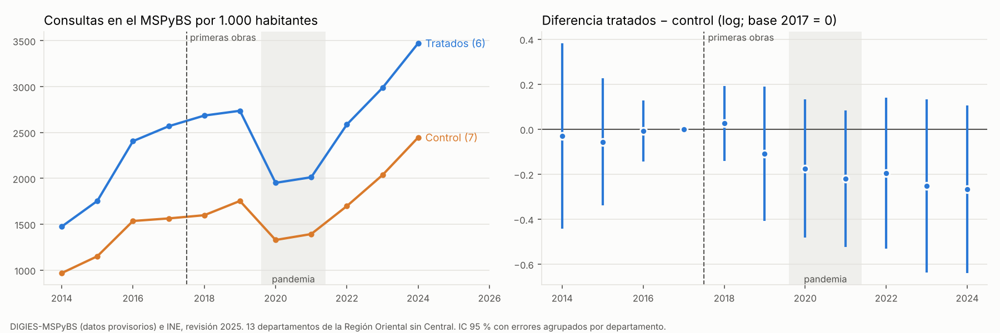

# Obras del MOPC y consultas en establecimientos del Ministerio de Salud (modelo departamental)

**Pregunta:** en los departamentos con más obras del MOPC en caminos vecinales y departamentales (2018-2023), ¿aumentaron más las consultas en los establecimientos del Ministerio de Salud que en los departamentos con menos obras?

**Cómo se hizo:** es el diseño departamental de `15_` y `20_`, pero el resultado son las consultas registradas por la DIGIES en cada región sanitaria (que coincide con el departamento). El plan se fijó y se subió **antes** de estimar (`PLAN_DE_ANALISIS.md`).

**Respuesta corta:**
- **No hay evidencia de que las obras aumentaran las consultas.** Las consultas por habitante crecieron mucho en todo el país, pero en los departamentos tratados crecieron **algo menos** (−0,22 en logaritmo, unos −19 %), sin significancia (p 0,25 en el wild bootstrap y 0,26 en la aleatorización). No se cumple el criterio del plan.
- **La diferencia negativa parece ser convergencia, no un efecto de las obras.** Los tratados partían de niveles mucho más altos (Misiones, Ñeembucú y Guairá están entre los de más consultas por habitante del país), y los departamentos con pocas consultas en 2014-2017 crecieron más. Si se controla ese nivel inicial (exploratorio), el efecto pasa a +0,16, también sin significancia.
- **Los 5 departamentos foco** (Concepción, San Pedro, Caaguazú, Caazapá y Canindeyú) crecieron más que el resto (+0,21 a +0,33 en logaritmo), pero tampoco es significativo y no depende de las obras: Concepción y Caaguazú son controles.
- **Con esta serie no se confirma la señal de la EPHC** (+3,5 pp en la consulta a un profesional, `20_`). Esta fuente mide otra cosa: el volumen total de consultas registradas, urbanas y rurales, muy influido por la expansión del sistema de registro.

Archivos: `base_modelo_consultas.csv` (base del modelo: 13 departamentos × 11 años, solo con las variables usadas), `resultados_did_consultas.csv`, `resultados_estudio_eventos.csv`, `descriptivos_por_grupo_anio.csv`, `consultas_mspbs_did.png`. Scripts: `_scripts/csm_01_did_consultas.py`, `_scripts/csm_02_grafico_consultas.py`.

## 1. Datos

| Elemento | Fuente y definición |
|---|---|
| Consultas | Consultas registradas en establecimientos del MSPyBS por región sanitaria y año, 2014-2024 (DIGIES, Sistema de Atención Ambulatoria; datos provisorios). `09_servicios_complementarios/MSPBS_DIGIES/` |
| Población | Población del departamento a mitad de año, INE, estimaciones y proyecciones distritales, revisión 2025 |
| Resultado | log(consultas por 1.000 habitantes) |
| Muestra | 13 departamentos de la Región Oriental, sin Asunción ni Central; 2014-2024 (143 observaciones) |
| Tratados | San Pedro, Canindeyú, Caazapá, Guairá, Misiones y Ñeembucú: los 6 con más obras vecinales y departamentales del MOPC por habitante rural (adjudicaciones 2018-2023), igual que en `15_` |

**Evolución por grupo** (consultas por 1.000 habitantes, total del grupo):

| Grupo | 2014-2017 (promedio) | 2022-2024 (promedio) | Cambio |
|---|---|---|---|
| Tratados (6) | 2.050 | 3.015 | +47 % |
| Control (7) | 1.304 | 2.060 | +58 % |

## 2. Especificación principal (la del plan)

$$\log(\text{consultas por 1.000})_{dt} = \alpha_d + \lambda_t + \beta\,(\text{Tratado}_d \times \text{Después}_t) + \varepsilon_{dt}$$

- **Antes** = 2014-2017; **después** = 2022-2024; se excluyen 2018-2021 (obras en curso y pandemia).
- **Inferencia:** wild cluster bootstrap por departamento (Webb, 999) y aleatorización exacta (1.716 asignaciones posibles).
- **Criterio:** β > 0 con p < 0,05 en las dos pruebas.

## 3. Resultados

| Modelo | Coeficiente (log) | IC 95 % | p wild | p aleatorización | n |
|---|---|---|---|---|---|
| **Principal: 2014-17 frente a 2022-24** | **−0,215** | [−0,63; +0,20] | 0,25 | 0,26 | 91 |
| S2 Tendencia previa diferencial 2014-2017 (por año) | +0,014 | [−0,16; +0,18] | 0,84 | | 52 |
| S3 Con tendencias lineales propias de cada departamento | +0,037 | [−0,45; +0,53] | 0,86 | | 143 |
| S4 Intensidad continua (por unidad de log(1 + Gs por hab. rural / 100.000)) | −0,140 | [−0,31; +0,03] | 0,26 | | 91 |
| S5 Diferencia adicional en los tratados que son departamentos foco | +0,327 | [−0,03; +0,68] | 0,09 | | 91 |
| S5b Departamentos foco frente al resto (exploratorio) | +0,209 | [−0,19; +0,60] | 0,23 | | 91 |
| E1 Principal + nivel inicial × después (exploratorio) | +0,160 | [−0,18; +0,50] | 0,33 | | 91 |

**Criterio del plan: no se cumple.**

### Estudio de eventos (base 2017)

- **Antes de las obras (2014-2016):** coeficientes cerca de cero (−0,06 a −0,01), así que los dos grupos venían creciendo a un ritmo parecido. Los intervalos de 2014 y 2015 son anchos.
- **2018:** +0,03.
- **Desde 2019:** los tratados quedan por debajo, de −0,11 en 2019 a −0,27 en 2024. Ningún año es significativo (p wild entre 0,14 y 0,47).
- **Pandemia:** la caída de 2020-2021 fue más fuerte en los tratados, en especial en Misiones, Ñeembucú y Guairá, que tenían muchas consultas por habitante, y la brecha no se cerró después.

## 4. Lectura

1. **El volumen de consultas no responde a las obras a escala departamental.** El efecto principal es negativo, chico respecto del crecimiento general (+47 % y +58 %) y no significativo.
2. **El signo negativo se explica mejor por convergencia:**
   - los tres departamentos con más consultas por habitante en 2014-2017 (Misiones, Ñeembucú y Guairá) son tratados;
   - los que más crecieron (Amambay, Concepción, Paraguarí y Caaguazú) partían de los niveles más bajos y son controles.

   Al controlar por el nivel inicial el coeficiente cambia de signo (+0,16), aunque con 13 departamentos ese control y el tratamiento están muy correlacionados y la estimación es imprecisa. Por eso se presenta como exploratoria.
3. **Las tendencias propias de cada departamento** (S3) llevan el efecto a +0,04: tampoco hay señal una vez que se permite que cada departamento crezca a su ritmo.
4. **Departamentos foco:** San Pedro, Canindeyú y Caazapá crecieron más que los otros tratados (S5, p 0,09), pero los foco que son controles (Concepción y Caaguazú) también crecieron mucho. Es un patrón del norte y centro del país, no de las obras.
5. **Relación con la EPHC (`20_`):** la encuesta mostraba +3,5 pp en la consulta a un profesional entre los enfermos rurales. Esta serie no lo confirma ni lo contradice del todo, porque:
   - mezcla población urbana y rural;
   - cuenta consultas, no personas;
   - incluye a los departamentos con más consultas, cuyo crecimiento tiene menos margen.

## 5. Limitaciones

- **Expansión del registro:** el sistema de información (HIS) pasó de unos 417 a más de 1.200 establecimientos que reportan. Si se amplió a ritmos distintos por departamento, eso domina la serie y no se puede separar de la atención real.
- **Escala gruesa:** el departamento mezcla zonas con y sin obra, y la consulta no distingue la residencia del paciente.
- **Pocos grupos:** son 13 departamentos.
- **Datos provisorios** según la DIGIES.
- **Adjudicado no es ejecutado.**

## 6. Qué haría falta

Para medir el efecto de un camino sobre el uso de la salud hacen falta **consultas por establecimiento** (puesto de salud o Unidad de Salud Familiar) y por año, para comparar los establecimientos cercanos a tramos intervenidos (`18_tramos_georreferenciados`) con los lejanos. Esos datos no son públicos; se pueden pedir a la DIGIES por la Ley 5282 de acceso a la información pública.
