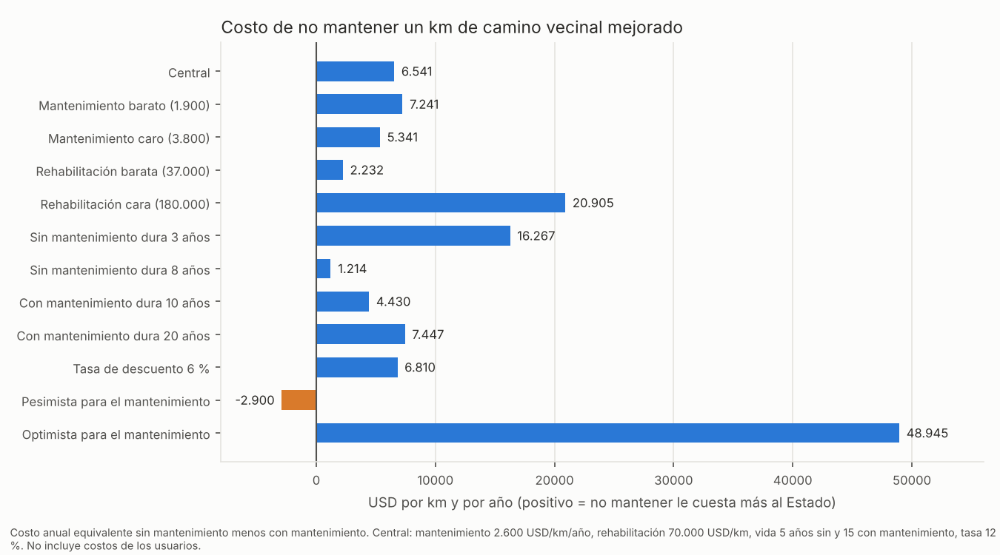
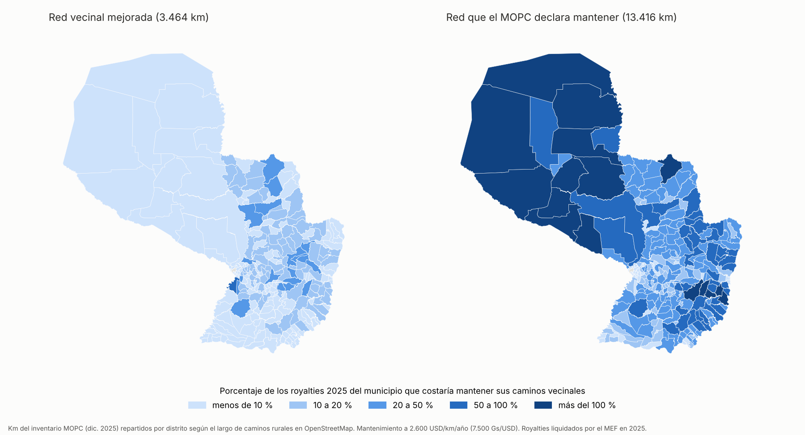
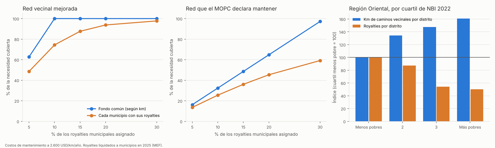

# Parte A: cuánto le cuesta al Estado no mantener los caminos vecinales, y una propuesta con royalties municipales

**Pregunta:** ¿Cuánto le cuesta al Estado no financiar de forma permanente el mantenimiento de los caminos vecinales mejorados, por km y por distrito? ¿Alcanzaría con destinar una parte de los royalties que reciben los municipios?

**Respuesta corta:**
1. **No mantener sale más caro.**
   - En el escenario central, cada km de camino vecinal mejorado sin mantenimiento le cuesta al Estado **unos 6.500 USD más por año** que mantenerlo.
   - **Cada dólar de mantenimiento ahorra unos 3,5 dólares en rehabilitaciones.**
   - El resultado se mantiene en casi todos los escenarios. Solo se invierte si, sin mantenimiento, el camino durara **más de 9 años**. Eso es poco probable en caminos de tierra o ripio, pero no tenemos un dato medido en Paraguay.
2. **En todo el país:**
   - Mantener los **3.464 km** de caminos vecinales mejorados (ripio, empedrado o asfalto) cuesta unos **68 mil millones de Gs por año** (9 millones de USD).
   - No mantenerlos cuesta unos **170 mil millones de Gs por año** en rehabilitaciones adelantadas, sin contar el costo para los usuarios.
3. **Los royalties alcanzan para la red mejorada, pero no para toda la red:**
   - Mantener la red mejorada equivale al **8 % de los royalties** liquidados a los municipios en 2025.
   - Mantener los 13.416 km que el MOPC declara mantener equivale al **31 %**.
   - Mantener toda la red vecinal (62.000 km) **supera el total de los royalties** (143 %).
4. **El diseño importa tanto como el porcentaje:**
   - **Si cada municipio financia sus propios caminos**, un 10 % de los royalties cubre solo el **74 %** de la red mejorada. A la vez, sobran 35 mil millones de Gs en municipios con pocos caminos.
   - **Con un fondo común repartido según los km**, el mismo 10 % cubre el **100 %**.
   - Los distritos más pobres tienen **60 % más km** de caminos vecinales y reciben **la mitad de royalties** que los menos pobres. Una asignación municipio por municipio los deja más desfinanciados.

**Archivos:**
- `base_costo_mantenimiento_distrital.csv`: base distrital con km, royalties, necesidad de mantenimiento, costo de no mantener y NBI.
- `escenarios_costo_por_km.csv`, `resumen_costo_mantenimiento.csv`, `resumen_por_departamento.csv`, `simulacion_royalties.csv`.
- Gráficos: `costo_no_mantener_escenarios.png`, `mapa_pct_royalties_necesario.png`, `simulacion_royalties.png`.
- Scripts: `_scripts/man_01_costo_no_mantenimiento.py` y `_scripts/man_02_graficos.py`.

> Esta parte es una **simulación de costos con supuestos explícitos**, no una estimación de impacto. El efecto del mantenimiento en las condiciones de vida corresponde a las Partes B y C de `PROPUESTA_costo_no_mantenimiento.md`.

## 1. Método

Se compara, por km de camino vecinal mejorado, el **costo anual equivalente** de dos políticas que se repiten en el tiempo:

| Política | Qué paga el Estado | Costo anual equivalente |
|---|---|---|
| **Con mantenimiento** | Mantenimiento todos los años (*m*) y una rehabilitación cada *vida con* años | $m + C \cdot FRC(r, \text{vida con})$ |
| **Sin mantenimiento** | Una rehabilitación cada *vida sin* años | $C \cdot FRC(r, \text{vida sin})$ |

- $FRC(r,n) = r / (1-(1+r)^{-n})$ es el factor de recuperación de capital: convierte una inversión que se repite cada *n* años en un costo anual.
- **Costo de no mantener** = costo anual sin mantenimiento − costo anual con mantenimiento.

### Parámetros (USD por km, fijados antes de calcular)

| Parámetro | Central | Rango | Fuente |
|---|---|---|---|
| Mantenimiento *m* (rutinario y conservación, por niveles de servicio o convenio) | 2.600 por año | 1.900-3.800 | Plan del MOPC para el BID (EEO 7, PR-L1092): contratos 2.573; convenios 2.602; PR-L1084 3.774; PR-L1092 1.870; CAF 2.200 |
| Rehabilitación *C* | 70.000 | 37.000-180.000 | 37.000: estimación del Banco Mundial (PAD 2006). 70.000: estimación más baja del MOPC (EEO 7, Concepción). 180.000: estimación del MOPC para tramos priorizados (EEO 7); el costo real en el proyecto del Banco Mundial fue 174.000-222.000 (ICR 2016) |
| Vida útil sin mantenimiento | 5 años | 3-8 | Supuesto: no hay datos de Paraguay |
| Vida útil con mantenimiento | 15 años | 10-20 | Supuesto; 15 años es el horizonte de las evaluaciones del Banco Mundial |
| Tasa de descuento | 12 % | 6 % | La usada en las evaluaciones económicas del Banco Mundial para estos proyectos |
| Tipo de cambio | 7.500 Gs/USD | | Promedio aproximado de 2025 |

**Elección conservadora:** el escenario central usa la rehabilitación más barata del MOPC (70.000 USD/km) y **no cuenta los costos de los usuarios** (vehículos, tiempo, días sin paso). Los dos supuestos achican el costo de no mantener.

### Km por distrito

- **Total por departamento:** km de caminos vecinales del inventario del MOPC (diciembre de 2025).
- **Reparto entre distritos:** según el largo de caminos rurales de OpenStreetMap (terciarios, sin clasificar y huellas) en cada distrito.
- **Misiones** no figura en la tabla del inventario y se imputó con la relación km MOPC / km OSM del resto de la Región Oriental.

Se usan tres redes:

| Red | Km | Qué representa |
|---|---|---|
| **Mejorada** | 3.464 | Caminos vecinales de ripio, ripio-empedrado, empedrado o asfalto: los caminos "construidos" |
| **MOPC declara** | 13.416 | La red que el MOPC informa que mantienen los distritos de conservación, repartida según la red vecinal total |
| **Total** | 62.030 | Toda la red vecinal, el 94 % de tierra |

**Royalties:** liquidación del MEF a los municipios en 2025 (262 municipios sin Asunción; 847.500 millones de Gs).

## 2. Resultados por km

| Escenario | Costo anual con mantenimiento | Costo anual sin mantenimiento | **Costo de no mantener (USD/km/año)** | USD ahorrados por USD de mantenimiento |
|---|---|---|---|---|
| **Central** | 12.878 | 19.419 | **6.541** | **3,5** |
| Mantenimiento barato / caro | 12.178 / 14.078 | 19.419 | 7.241 / 5.341 | 4,8 / 2,4 |
| Rehabilitación barata / cara | 8.033 / 29.028 | 10.264 / 49.934 | 2.232 / 20.905 | 1,9 / 9,0 |
| Sin mantenimiento dura 3 / 8 años | 12.878 | 29.144 / 14.091 | 16.267 / 1.214 | 7,3 / 1,5 |
| Con mantenimiento dura 10 / 20 años | 14.989 / 11.972 | 19.419 | 4.430 / 7.447 | 2,7 / 3,9 |
| Tasa de descuento 6 % | 9.807 | 16.618 | 6.810 | 3,6 |
| Todo en contra del mantenimiento | 10.348 | 7.448 | **−2.900** | 0,2 |
| Todo a favor del mantenimiento | 25.998 | 74.943 | 48.945 | 26,8 |

- **En los escenarios que cambian un supuesto a la vez, mantener siempre conviene.** Solo deja de convenir si se juntan todos los supuestos desfavorables: rehabilitación barata, mantenimiento caro, y un camino que sin mantenimiento dura 8 años.
- **El dato que más pesa es cuánto dura un camino sin mantenimiento.** En el escenario central, mantener conviene mientras ese plazo sea **menor a 9,3 años**. Medirlo es el aporte más útil que puede hacer la Parte B (tramos rehabilitados en 2012-2018 y su estado actual).

## 3. Resultados por departamento y distrito

| | País | Región Oriental | 5 dptos. foco |
|---|---|---|---|
| Km de red vecinal / mejorada | 62.030 / 3.464 | 49.205 / 3.401 | 18.864 / 1.351 |
| Royalties municipales 2025 (miles de millones de Gs) | 847,5 | 808,9 | 216,6 |
| **Mantener la red mejorada** (miles de millones de Gs por año) | **67,6** | 66,3 | 26,3 |
| **Costo de no mantener la red mejorada** (miles de millones de Gs por año) | **170,0** | 166,8 | 66,3 |
| % de los royalties: red mejorada | **8,0 %** | 8,2 % | 12,2 % |
| % de los royalties: red que el MOPC declara mantener | **30,9 %** | 25,7 % | 36,7 % |
| % de los royalties: red total | 142,7 % | 118,6 % | 169,9 % |

**Por departamento** (porcentaje de sus royalties municipales):
- **Red mejorada:** va del 1,6 % (Ñeembucú) al 18,1 % (Caaguazú).
- **Red que el MOPC declara mantener:**
  - de 13 % a 54 % en la Región Oriental (Canindeyú 54 %, Caazapá 44 %, Amambay 42 %, San Pedro 36 %);
  - más del 85 % en el Chaco (Alto Paraguay 259 %).

**Por distrito**, para la red mejorada:
- 161 de 262 distritos necesitarían menos del 10 % de sus royalties;
- 82 necesitarían entre 10 % y 20 %;
- 19 necesitarían más del 20 %.

### Equidad: los distritos más pobres tienen más caminos y menos royalties

| Región Oriental, cuartil de NBI 2022 | Km vecinales por distrito | Royalties por distrito (miles de millones de Gs) | % de royalties necesario, mediana (red MOPC) | Ídem (red mejorada) |
|---|---|---|---|---|
| Menos pobres | 149 | 4,55 | 14,7 % | 5,6 % |
| 2 | 200 | 3,96 | 21,9 % | 8,6 % |
| 3 | 219 | 2,46 | 27,6 % | 8,1 % |
| **Más pobres** | **239** | **2,28** | **34,3 %** | **10,7 %** |

Los royalties se reparten sobre todo por población y en montos parecidos por municipio; los caminos vecinales están en los distritos rurales y pobres. Por eso **una misma regla porcentual exige un esfuerzo mucho mayor a los municipios más pobres**. La correlación de Spearman entre el NBI y el porcentaje necesario es 0,46.

## 4. Simulación de la propuesta: un porcentaje de los royalties para mantenimiento

Se comparan dos diseños:
- **A. Cada municipio con lo suyo:** cada municipio destina el p % de sus royalties a los caminos vecinales de su distrito, y lo que sobra queda sin usar para esa finalidad.
- **B. Fondo común:** el p % de todos los royalties municipales va a un fondo (nacional o departamental) que se reparte según los km a mantener.

| p % de los royalties | Fondo (miles de millones de Gs) | Red mejorada: cobertura A | Red mejorada: cobertura B | Red MOPC: cobertura A | Red MOPC: cobertura B |
|---|---|---|---|---|---|
| 5 % | 42,4 | 48 % | 63 % | 14 % | 16 % |
| **10 %** | **84,8** | **74 %** (sobran 34,5) | **100 %** | 26 % | 32 % |
| 15 % | 127,1 | 88 % | 100 % | 36 % | 49 % |
| 20 % | 169,5 | 94 % | 100 % | 45 % | 65 % |
| 30 % | 254,3 | 98 % | 100 % | 59 % | 97 % |

- **Con un fondo común, el 8 % de los royalties municipales mantiene toda la red vecinal mejorada.** El ahorro neto en rehabilitaciones sería de unos **170 mil millones de Gs por año** (escenario central).
- **Con el diseño A hace falta un porcentaje mucho mayor:** con 10 % queda un 26 % de la red mejorada sin cubrir, y el sobrante se concentra en municipios urbanos con pocos caminos.
- **La red que el MOPC declara mantener (13.416 km)** necesita alrededor del 31 % de los royalties con fondo común y no se cubre con el diseño A. Para esa red, los royalties pueden ser **una fuente complementaria**, no la única.

## 5. Propuesta de política pública

**Medida:** asignar por ley un porcentaje de los royalties municipales al mantenimiento rutinario y periódico de los caminos vecinales mejorados, a través de un fondo con reglas de reparto por km y pago por resultados.

1. **Cuánto:** **8 a 10 % de los royalties municipales** para la red mejorada (unos 68 a 85 mil millones de Gs por año). Si se quiere cubrir la red de 13.416 km, sumar un aporte del MOPC por un monto equivalente, en lugar de subir el porcentaje de los municipios.
2. **Cómo se reparte:** un **fondo común por departamento**, administrado por la gobernación con el distrito de conservación del MOPC, que asigna los recursos **según los km mejorados a mantener**, no según los royalties de cada municipio. Esto corrige el sesgo contra los distritos pobres y rurales.
3. **Quién ejecuta:** convenios MOPC-municipio o gobernación, una modalidad que ya existe (el MOPC tenía 2.152 km previstos "por convenios"). Pueden ejecutar microempresas o cuadrillas locales, con **pago contra certificación del nivel de servicio** (transitabilidad, cunetas y alcantarillas limpias), como en los contratos por niveles de servicio.
4. **Marco legal:**
   - La Ley 3984/2010 ya ordena que los municipios usen el 80 % de los royalties en gastos de capital, el 10 % en desarrollo sustentable y hasta el 10 % en gastos corrientes vinculados (texto a verificar en la versión vigente).
   - El **mantenimiento periódico** (perfilado, recargo de ripio) puede clasificarse como gasto de capital porque prolonga la vida útil. El **rutinario** suele ser gasto corriente y entraría en el 10 %.
   - Hacer obligatoria la asignación y crear el fondo común requiere **modificar la Ley 3984/2010**. Ya hubo modificaciones transitorias de su artículo 5 (Ley 6528).
5. **Transparencia:** publicar por distrito y por año los km mantenidos, el monto pagado y el estado certificado. Además de dar control ciudadano, esto genera los datos que hoy faltan para medir el impacto (Partes B y C).

## 6. Limitaciones

- **Costos unitarios:** vienen de documentos de planificación del MOPC y de los organismos (2006-2016), en dólares corrientes y sin actualizar a 2025. Probablemente subestiman los dos costos. La conclusión depende sobre todo de la relación entre rehabilitar y mantener, y esa relación es más estable.
- **Vida útil con y sin mantenimiento:** son supuestos. Es el parámetro que más pesa y conviene medirlo (Parte B1).
- **Km por distrito:** son una aproximación (inventario departamental repartido según OpenStreetMap). Misiones está imputado. "Red mejorada" se define por superficie y puede dejar afuera caminos de tierra terraplenados que también se "construyeron".
- **Royalties:** se usó un solo año. En 2025 los royalties fueron menores que en 2024 (848 frente a 1.138 mil millones de Gs, con una correlación entre municipios de 0,97). Con los montos de 2024, los porcentajes serían alrededor de un 25 % más bajos.
- **Usuarios:** no se incluyen sus costos (operación vehicular, tiempo, días sin paso). En el programa PR-L1084 del BID, los días transitables pasaron del 75 % al 100 % y el tránsito se duplicó. Incluirlos agrandaría el costo de no mantener.
- **Sin impacto en condiciones de vida:** esta parte no mide el efecto en la pobreza, la salud o la educación (ver Partes B y C).

## Fuentes externas consultadas

- Ley 3984/2010, distribución de royalties a gobiernos departamentales y municipales: [BACN](https://www.bacn.gov.py/leyes-paraguayas/3520/ley-n-3984-establece-la-distribucion-y-deposito-de-parte-de-los-denominados-)
- Ley 6528, modificación transitoria del artículo 5: [BACN](https://www.bacn.gov.py/leyes-paraguayas/9212/ley-n-6528-modifica-de-manera-transitoria-el-articulo-5-y-amplia-la-ley-n-39842010-que-establece-la-distribucion-y-deposito-de-parte-de-los-denominados-royalties-y-compensaciones-en-razon-del-territorio-inundado-a-los-gobiernos-departamentales-y-municipales)
- Tipo de cambio 2025: [CEPAL](https://repositorio.cepal.org/server/api/core/bitstreams/916d39cd-5abe-444c-b1db-52d1f3fa62ab/content), [La Nación](https://www.lanacion.com.py/negocios/2025/07/29/guarani-en-movimiento-claves-para-entender-su-dinamica-este-ano/)
