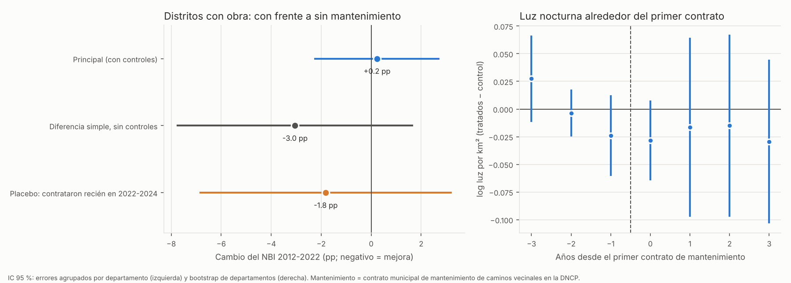

# Mantenimiento de caminos vecinales y condiciones de vida: diferencias en diferencias

**Pregunta:** en los distritos donde el MOPC construyó o mejoró caminos vecinales, ¿mejoraron más las condiciones de vida donde esos caminos recibieron mantenimiento que donde no lo recibieron?

**Método del curso:** diferencias en diferencias. Los otros métodos del mapa de diseño no aplican:
- **Experimento:** no hubo sorteo.
- **Regresión discontinua:** no hay una regla de puntaje.
- **Variables instrumentales:** no hay un instrumento creíble.

El plan se fijó y se subió **antes** de estimar (`PLAN_DE_ANALISIS.md`).

**Respuesta corta:**
- **No se encontró un efecto del mantenimiento en las condiciones de vida.** No se cumple el criterio del plan en ninguno de los dos diseños.
- **Diseño distrital (NBI 2012-2022):**
  - Sin controles, en los distritos con mantenimiento el NBI bajó **3 puntos más**.
  - Pero esos distritos partían más pobres. Al comparar distritos del mismo departamento y con el mismo nivel inicial, la diferencia es **+0,2 puntos** (IC 95 % de −2,2 a +2,7), es decir, cero.
  - El **placebo** muestra una diferencia parecida (−1,8) en municipios que contrataron mantenimiento recién en 2022-2024, cuando ya no podía afectar al censo. La diferencia simple refleja **qué municipios contratan**, no el efecto del mantenimiento.
- **Diseño departamental** (contrato del MOPC por niveles de servicio de 2022):
  - Consulta a un profesional de salud: **−0,5 puntos**, sin efecto.
  - Asistencia escolar de 12 a 17 años: +2,8 puntos (p 0,06 y 0,12). Es un resultado secundario y no alcanza el criterio.
- **Qué se puede afirmar:** con estos datos se pueden **descartar efectos grandes**. Mejoras del NBI mayores a unos 2 puntos por tener mantenimiento son poco compatibles con los datos. No se puede afirmar que el mantenimiento no tenga efecto: el tratamiento está mal medido (ver sección 5).

**Archivos:**
- `base_modelo_distrital_mantenimiento.csv`: base del modelo distrital, solo con las variables usadas.
- `contratos_mantenimiento_municipal_2012_2025.csv`: los 384 contratos municipales usados para definir el tratamiento.
- `resultados_did_mantenimiento.csv`, `resultados_luces_estudio_eventos.csv`, `descriptivos_distritales.csv`, `did_mantenimiento.png`.
- Scripts: `_scripts/mnt_01_did_mantenimiento.py` y `_scripts/mnt_02_grafico.py`.

## 1. Diseño principal: diferencias en diferencias distrital

| Elemento | Definición |
|---|---|
| **Unidades** | 76 distritos de la Región Oriental (sin Central), con límites estables entre los censos y con al menos una obra vecinal del MOPC adjudicada entre 2012 y 2016 |
| **Tratados (28)** | La municipalidad adjudicó al menos un contrato de mantenimiento, reparación, perfilado o enripiado de caminos vecinales entre 2012 y 2020 (DNCP) |
| **Control (48)** | Distritos con obra, sin esos contratos |
| **Resultado** | Cambio del % de hogares con al menos una NBI, Censo 2012 a Censo 2022 |
| **Contrafactual** | Lo que bajó el NBI en los distritos con obra y sin mantenimiento del mismo departamento, con nivel inicial, ruralidad, densidad, monto de obra, royalties por habitante y lluvia parecidos |
| **Supuesto** | Sin el mantenimiento, el NBI de los dos grupos habría bajado en paralelo |
| **Inferencia** | Wild bootstrap por departamento y permutación del tratamiento dentro de cada departamento |

**Los dos grupos:**

| | Distritos | NBI 2012 | NBI 2022 | Cambio | % rural | Royalties por habitante (miles de Gs) |
|---|---|---|---|---|---|---|
| Con mantenimiento | 28 | 57,9 | 33,5 | **−24,4** | 66,9 | 227 |
| Sin mantenimiento | 48 | 54,3 | 32,9 | **−21,4** | 64,0 | 298 |

Los distritos con mantenimiento partían **3,6 puntos más pobres**. Los distritos más pobres en 2012 bajaron más el NBI en todo el país (convergencia), así que la diferencia simple de −3 puntos mezcla las dos cosas.

## 2. Resultados

| Modelo | Coeficiente (pp de NBI) | IC 95 % | p wild | p permutación | n |
|---|---|---|---|---|---|
| **Principal: con controles y efectos fijos de departamento** | **+0,2** | [−2,2; +2,7] | 0,86 | 0,85 | 76 |
| S1 Diferencia simple 2×2 | −3,0 | [−7,7; +1,6] | 0,21 | 0,50 | 76 |
| S2 Triple diferencia: obra × mantenimiento (203 distritos) | +0,8 | [−1,4; +3,1] | 0,44 | | 203 |
| S3 Intensidad: por cada año con contrato | −0,1 | [−0,6; +0,5] | 0,83 | | 76 |
| S4 Placebo: primer contrato en 2022-2024 frente a nunca | −1,8 | [−6,8; +3,2] | 0,47 | 0,32 | 128 |
| S5 Luz nocturna, promedio de los años 0 a +3 (log) | −0,02 | [−0,09; +0,04] | | | 53 / 115 |

**Criterio del plan** (β < 0 con p < 0,05 en las dos pruebas): **no se cumple.**

- **Placebo (S4):** en 9 municipios que contrataron mantenimiento por primera vez en 2022-2024, el NBI 2012-2022 ya había bajado 1,8 puntos más que en los que nunca contrataron. Ese mantenimiento no pudo influir en el censo, así que la parte "favorable" de la diferencia simple se explica por **quién contrata**. En el plan no se especificó la submuestra del placebo; se usó la muestra completa sin los tratados 2012-2020 (128 distritos), porque con solo los distritos con obra quedaban muy pocos casos.
- **Luz nocturna (S5):** los grupos venían parejos antes del primer contrato (coeficientes previos entre −0,02 y +0,03) y no cambian después (−0,02 en promedio). No hay señal de más actividad económica.

## 3. Complemento: diferencias en diferencias departamental

- **Tratados:** los 8 departamentos cubiertos por el contrato del MOPC de mantenimiento de caminos rurales por niveles de servicio (LPI 47/2021, adjudicado en 2022): Concepción, San Pedro, Guairá, Caazapá, Itapúa, Alto Paraná, Amambay y Canindeyú.
- **Control:** los 5 restantes (Cordillera, Caaguazú, Misiones, Paraguarí y Ñeembucú).
- **Antes y después:** 2017-2019 frente a 2023-2025.
- **Separación de la construcción:** se controla por el tratamiento de obras de `15_`.

| Resultado | Base antes (tratados) | Coeficiente | IC 95 % | p wild | p aleatorización |
|---|---|---|---|---|---|
| **Consulta a un profesional si estuvo enfermo** (principal) | 65,9 % | **−0,5 pp** | [−3,4; +2,3] | 0,73 | 0,72 |
| Asistencia escolar de 12 a 17 años | 82,1 % | +2,8 pp | [+0,3; +5,3] | 0,06 | 0,12 |
| Log consultas del MSPyBS por 1.000 habitantes | | +0,06 | [−0,33; +0,44] | 0,71 | 0,74 |

**Criterio del plan:** no se cumple. La asistencia escolar va en la dirección esperada, pero es un resultado secundario y no pasa la prueba de aleatorización.

## 4. Lectura para el informe

1. **Contra qué se compara:** con distritos con caminos construidos y sin contratos de mantenimiento, del mismo departamento y con condiciones iniciales parecidas.
2. **Hallazgo:** no se observa que el mantenimiento contratado por los municipios mejore el NBI, la luz nocturna o el acceso a salud. La diferencia que aparece sin controles se explica por qué municipios contratan, como muestra el placebo.
3. **Magnitud que se puede descartar:** reducciones del NBI mayores a unos 2,2 puntos.
4. **Relación con la Parte A:**
   - El argumento a favor de financiar el mantenimiento es **fiscal**: cuidar la inversión y evitar rehabilitaciones adelantadas.
   - Con los datos públicos actuales no se puede sostener además que mejore las condiciones de vida, ni lo contrario.
   - Para medirlo hace falta el diseño experimental del piloto (Parte C).

## 5. Limitaciones

- **Tratamiento mal medido:**
  - Los contratos municipales en la DNCP son una parte chica del mantenimiento.
  - El MOPC (13.416 km declarados por sus distritos de conservación) y los propios municipios mantienen caminos con sus máquinas, y eso no se registra por distrito.
  - Muchos "controles" probablemente tuvieron mantenimiento, lo que lleva el efecto hacia cero. Es la limitación principal.
- **Resultado lejano:** el NBI mide vivienda, saneamiento, educación y capacidad de subsistencia. Es poco sensible al estado de un camino.
- **Dos censos:** no se pueden probar las tendencias paralelas del NBI. La luz nocturna sirve como verificación indirecta.
- **Diseño departamental:** son 13 departamentos (8 tratados y 5 de control). El contrato de 2022 cubre "áreas geográficas" que no sabemos ubicar dentro de cada departamento.
- **Adjudicado no es ejecutado.**

## 6. Qué permitiría una evaluación más firme

1. **Datos del MOPC** (Ley 5282): km mantenidos por distrito y año, y los tramos de cada contrato por niveles de servicio. Con eso el tratamiento quedaría bien medido y el mismo diseño de diferencias en diferencias ganaría precisión.
2. **El piloto con incorporación escalonada al azar** (Parte C de `22_propuesta_mantenimiento/PROPUESTA_costo_no_mantenimiento.md`). Es el **experimento** del mapa de diseño: el método más fuerte del curso para responder la segunda mitad de la pregunta.
