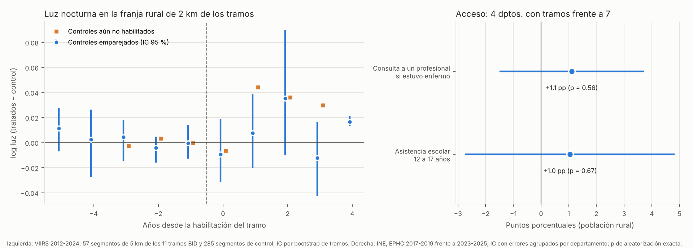

# Análisis de impacto: los 11 tramos rehabilitados con el BID y la persistencia de sus efectos

**Problema de investigación (memorando al Ministro del MOPC):** la falta de mantenimiento de los caminos vecinales ya intervenidos pone en riesgo la conectividad lograda y sus beneficios para las comunidades rurales.

**Preguntas de impacto:**
1. ¿Qué cambió en las comunidades cercanas cuando se habilitaron los 11 tramos (334 km, Gs 276 mil millones)? Es lo que el mantenimiento protege.
2. ¿Ese cambio se mantiene o se desvanece con los años? Sin mantenimiento, debería desvanecerse.

**Método del curso:** diferencias en diferencias escalonado. El plan se fijó y se subió **antes** de estimar (`PLAN_DE_ANALISIS.md`).

## Primera página del informe

**Hallazgo en una oración:** en los primeros dos a cuatro años después de habilitarse, los 11 tramos no muestran efectos detectables. No cambió más la luz nocturna en las comunidades cercanas, ni mejoraron más la consulta de salud o la asistencia escolar en los departamentos con tramos. Tampoco hay señales de que un efecto se esté desvaneciendo.

**Magnitud en unidades de decisión:**

| Resultado | Efecto estimado | Qué se puede descartar |
|---|---|---|
| **Luz nocturna** en la franja rural de 2 km (diseño principal) | **+1,9 %** (IC 95 %: −6 % a +5 %) | Aumentos de la actividad local mayores a un 5 % en los dos primeros años |
| **Consulta a un profesional** si estuvo enfermo (población rural, base 62 %) | **+1,1 puntos**: alrededor de 1 persona más de cada 100 enfermos (IC −1,5 a +3,7) | Aumentos mayores a unos 4 de cada 100 |
| **Asistencia escolar** de 12 a 17 años (base 82 %) | **+1,0 punto** (IC −2,7 a +4,8) | Aumentos mayores a unos 5 de cada 100 |

Ninguno cumple el criterio fijado en el plan.

**Contrafactual:**
- **Luz:** la evolución de los tramos que todavía no se habían habilitado (mismo programa y misma selección) y la de caminos rurales parecidos, sin obra y con la misma luz inicial.
- **Acceso:** la evolución de los 7 departamentos sin tramos.

**Supuesto:** sin la habilitación, las comunidades de los tramos habrían seguido la misma tendencia que sus controles. Antes de la habilitación los dos grupos venían parejos: −5 a −2 años, +0,004 (IC −0,011 a +0,014).

**La afirmación más sólida que soportan los datos:** "Con los datos públicos disponibles no se puede mostrar que estos caminos hayan cambiado la actividad económica o el acceso a servicios en sus primeros años, ni que sus beneficios se estén perdiendo. Se pueden descartar efectos grandes." El argumento a favor del mantenimiento se apoya en el **costo** (Parte A: cada dólar de mantenimiento evita entre 1,2 y 4,4 en rehabilitaciones) y en la evidencia internacional. Para medir el efecto en las condiciones de vida hace falta el sorteo escalonado que propone el entregable.

## 1. Elección del diseño (mapa del curso)

| Pregunta del mapa | Respuesta |
|---|---|
| ¿Alguien controla quién recibe el programa? → **experimento** | No para el pasado. Es el diseño propuesto para el mantenimiento futuro (entregable del track 3, diapositiva 8) |
| ¿Una regla asigna según un puntaje o umbral? → **regresión discontinua** | No hay una regla pública de puntaje para elegir tramos |
| ¿Un cambio afectó a unas unidades y no a otras? → **diferencias en diferencias** | **Sí:** los tramos se habilitaron entre 2019 y 2024. Cada año hay tramos ya habilitados y tramos todavía no habilitados del mismo programa |
| ¿Algo casi al azar cambia la exposición? → **variables instrumentales** | No hay un instrumento creíble |

## 2. Revisión forense de los datos

- **Planilla de tramos:**
  - los 11 tramos suman 333,9 km y Gs 276.288 millones;
  - las fechas de habilitación van de diciembre de 2019 a agosto de 2024;
  - el trazado se aproxima con líneas rectas entre extremos (unos 260 km rectos frente a 334 km declarados).
- **Luz nocturna (VIIRS VNL v2):**
  - es anual y llega a 2024, así que los tramos de 2023 y 2024 tienen solo uno o dos años "después";
  - las zonas rurales son muy oscuras: el nivel medio en log antes de la habilitación es 0,17;
  - se excluyeron las áreas urbanas del Censo 2022 para no medir el alumbrado de los pueblos.
- **Encuesta de hogares (EPHC):** representativa por departamento, no por tramo.
  - En 2018-2021 el departamento se recuperó por el conglomerado de la muestra (`15_`).
  - Los años 2020-2022 se excluyen por la pandemia.
- **Lo que no se pudo usar:**
  - la matrícula del MEC por escuela (el portal datos.mec.gov.py corta la conexión);
  - las consultas por establecimiento de salud (no son públicas);
  - el Censo 2022 por localidad (no trae educación ni salud y no tiene una línea de base de 2012).

## 3. Diseño A (principal): luz nocturna a escala local

**Unidades:**
- 57 segmentos de 5 km de los 11 tramos, cada uno con su franja rural de 2 km a cada lado.
- Cohortes según el año de habilitación: 2020 (14 segmentos), 2021 (8), 2022 (17), 2023 (15) y 2024 (3).

**Estimador:** del tipo Callaway y Sant'Anna. La base es el promedio de los 3 años previos a la habilitación.
- **A1 (principal):** compara con los segmentos de tramos que todavía no se habían habilitado.
- **A2 (secundario):** compara con 285 segmentos de caminos rurales de OpenStreetMap de los mismos departamentos, lejos de cualquier obra, con 5 controles por segmento tratado elegidos por su luz inicial.
  - El emparejamiento funcionó: la luz media en 2014-2016 es 0,059 en tratados y controles.

| Modelo | Efecto (log luz) | IC 95 % | p aleatorización |
|---|---|---|---|
| **A1 Principal: aún no habilitados, años 0 a +2** | **+0,019** | [−0,061; +0,054] | 0,65 |
| A2 Controles emparejados, años 0 a +2 | +0,009 | [−0,019; +0,041] | |
| A2 Tendencias previas, años −5 a −2 | +0,004 | [−0,011; +0,014] | |
| A2 **Persistencia**: cambio del efecto por año, años 0 a +4 | +0,006 por año | [−0,002; +0,022] | |

**Inferencia:**
- Los intervalos son de un bootstrap que remuestrea tramos enteros (11 conglomerados).
- La aleatorización reasigna las fechas de habilitación entre los 11 tramos.
- El año +4 en A2 se basa en solo 2 tramos (los de 2020), por eso su intervalo es engañosamente angosto.

**Criterio del plan:** no se cumple.

**Persistencia:** el efecto no se achica con los años; la pendiente es levemente positiva y no significativa. Pero la ventana es corta (2 a 4 años después de la habilitación) y la luz nocturna capta poco el estado del camino. **Esta prueba no puede confirmar ni descartar el deterioro.**

## 4. Diseño B (principal de acceso): departamental con la EPHC

**Comparación:**
- **Tratados:** los 4 departamentos con al menos 30 km de tramos (San Pedro, Caaguazú, Caazapá y Canindeyú).
- **Control:** los otros 7 departamentos de la Región Oriental sin Central.
- **Excluidos:** Cordillera e Itapúa, con tramos chicos.
- **Antes y después:** 2017-2019 frente a 2023-2025.
- **Control adicional:** el resto de las obras del MOPC.

| Resultado (población rural) | Base antes | Efecto | IC 95 % | p wild | p aleatorización (330 asignaciones) |
|---|---|---|---|---|---|
| **Consulta a un profesional si estuvo enfermo** | 62,1 % | **+1,1 pp** | [−1,5; +3,7] | 0,39 | 0,56 |
| Asistencia escolar de 12 a 17 años | 81,5 % | +1,0 pp | [−2,7; +4,8] | 0,58 | 0,67 |

**Criterio del plan:** no se cumple.

## 5. Lista del escéptico (y nuestras respuestas)

1. **"Los tramos no se eligieron al azar."**
   - **Respuesta:** el control principal son tramos del mismo programa habilitados más tarde, que pasaron por la misma selección.
   - Antes de la habilitación los grupos venían parejos.
2. **"La luz nocturna no mide el acceso a servicios."**
   - **Respuesta:** es cierto. Por eso el diseño B mide consulta y asistencia, aunque a escala departamental.
   - Los dos diseños coinciden: no hay efectos grandes.
3. **"Muy pocos años después."**
   - **Respuesta:** también es cierto. Los efectos de un camino pueden tardar más, y los datos llegan a 2024.
   - Por eso hablamos de "primeros años" y no de "ningún efecto".
4. **"Con 11 tramos no hay potencia."**
   - **Respuesta:** sí, por eso informamos lo que se puede descartar (efectos grandes) y no afirmamos que el efecto sea cero.
5. **"No sabemos si se mantuvieron."**
   - **Respuesta:** correcto. La prueba de persistencia es indirecta.
   - El registro de mantenimiento por tramo no existe, y crearlo es parte de la propuesta.

## 6. Qué significa para el memorando y la presentación

**Idea central de la propuesta:** el mantenimiento sostiene los beneficios logrados y, a la vez, reduce el gasto del MOPC. Los datos la respaldan en dos niveles distintos:

- **Beneficios directos de los caminos (están documentados):**
  - El informe de terminación del BID (PR-L1084, que incluye 9 de los 11 tramos) mide, antes y después de las obras: días transitables del 75 % al 100 %, costo de operación vehicular −25 %, tiempo de viaje −40 % y tránsito diario de 156 a 320 vehículos.
  - Son exactamente los beneficios que se pierden si el camino se deteriora. En el entregable se valoran como el ahorro de los usuarios que el mantenimiento sostiene (`24_.../escenarios_beneficios_sostenidos.csv`).
- **Ahorro para el MOPC (también está respaldado):**
  - con lo que costó rehabilitar 1 km de estos tramos se mantienen 42 km durante un año;
  - en 15 años, mantener cuesta unos USD 109.000 por km frente a USD 210.000 de rehabilitar cada 5 años (`22_` y `24_`).
- **Efectos de segundo orden (luz nocturna, consulta de salud, asistencia escolar):** este análisis no los detecta en los primeros años. Es coherente con lo que dice el propio BID: esos impactos "se efectivicen a lo largo del tiempo". Por eso la propuesta no promete efectos en la pobreza; promete sostener los beneficios directos y medir el resto con el sorteo escalonado.

### Notas anteriores

- **El caso a favor del mantenimiento se apoya en el costo** (Parte A, `22_`). Mantener cuesta menos que rehabilitar en casi todos los escenarios, y eso no depende de medir efectos en la pobreza.
- **No conviene prometer efectos en las condiciones de vida con datos de Paraguay.**
  - Los análisis del repositorio no los detectan: obras del MOPC (`15_`, `16_`, `20_`), contratos de mantenimiento (`23_`) y este análisis (`25_`).
  - Los efectos esperados vienen de evaluaciones de otros países.
- **El sorteo escalonado del mantenimiento** (diapositiva 8) es la forma de medir lo que hoy no se puede. Con el resultado principal en el estado del camino (días con paso y rugosidad), tiene potencia para detectar efectos grandes. Además genera los datos que faltan.

## Archivos

| Archivo | Contenido |
|---|---|
| `PLAN_DE_ANALISIS.md` | Plan fijado antes de estimar |
| `panel_luces_segmentos_2012_2024.csv` | Base del modelo A: luz anual por segmento tratado y de control |
| `segmentos_tratados_y_controles.gpkg` | Segmentos tratados y de control (mapa) |
| `resultados_impacto.csv`, `resultados_estudio_eventos.csv` | Resultados |
| `impacto_tramos_bid.png` | Gráfico |

Scripts: `_scripts/imp_01_segmentos_y_luces.py` (necesita el `roads.gpkg` de HOT OSM descomprimido), `_scripts/imp_02_estimaciones.py` y `_scripts/imp_03_grafico.py`.
